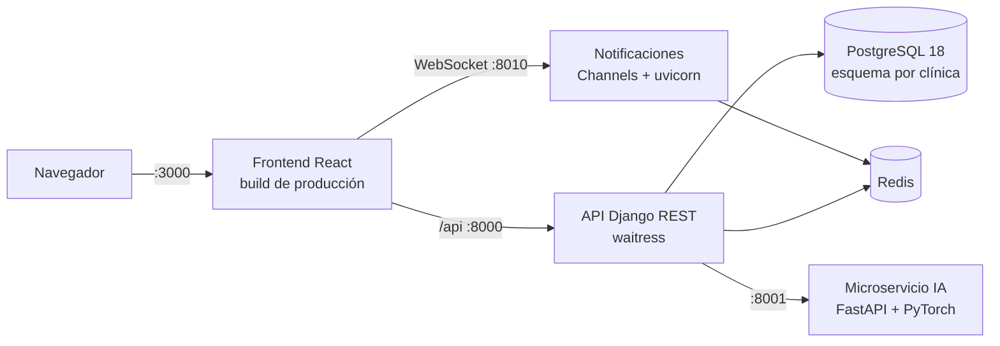

# Fetal Medical Bolivia

**Sistema web de historia clínica gineco-obstétrica con análisis de ecografías mediante redes neuronales.**
**Web-based obstetric and gynecological health record system with neural-network ultrasound analysis.**

[Español](#español) · [English](#english)

| | |
|---|---|
| Frontend | React 18 + TypeScript + Ant Design 5 |
| API | Django 6 + Django REST Framework 3.17 + django-tenants (PostgreSQL schemas) |
| Notificaciones en vivo / Live notifications | Django Channels + Redis |
| Inteligencia artificial / AI | FastAPI + PyTorch (13 redes) y scikit-learn (2 modelos tabulares) |
| Base de datos / Database | PostgreSQL 18 |
| Autor / Author | Miguel Mirkof Becerra Guzmán ([@Mirkof69](https://github.com/Mirkof69)) |

---

## Español

### Qué es

Fetal Medical Bolivia acompaña la atención de la paciente desde su registro hasta el alta: datos personales cifrados,
embarazo, antecedentes, controles prenatales con alertas clínicas, triaje de enfermería, laboratorio con rangos de
referencia, ecografías con biometría fetal, parto con partograma y recién nacidos, epicrisis, notas de evolución,
vacunas, citas y reportes. Incluye un microservicio de IA que analiza ecografías y cardiotocografías.

### Funciones principales

- **Cinco roles** con permisos por módulo y acción: administrador, médico, enfermería, laboratorio y recepción.
- **Seguridad:** doble factor (TOTP) para administración y médicos, bloqueo por intentos fallidos, sesión en cookies
  httpOnly con CSRF, cifrado de nombre, CI, teléfono, correo y dirección, auditoría inmutable de cada acción.
- **Historia clínica completa:** embarazo con FUM, FPP y edad gestacional; controles prenatales con alertas de
  presión arterial, FCF y proteinuria; triaje con prioridad; laboratorio con interpretación automática (incluido el
  criterio IADPSG de diabetes gestacional); ecografías con peso fetal Hadlock; parto, partograma, Apgar, Capurro y
  epicrisis.
- **Inteligencia artificial:** plano anatómico fetal, segmentación de cabeza, abdomen, tórax y fémur, circunferencia
  cefálica, anomalías cerebrales, ángulo de progresión intraparto, ecografía ginecológica (ovario, mioma, ovario
  poliquístico), cardiotocografía y peso al nacer. Cada modelo publica su métrica medida en la *Guía de IA*.
- **Calculadoras clínicas:** Bishop, IMC y ganancia de peso, riesgo de preeclampsia, crecimiento fetal, riesgo
  cromosómico, hemorragia obstétrica, bienestar fetal y dosis de medicamentos.
- **Agenda de citas** con turnos por médico, **reportes** e indicadores, **notificaciones en vivo**, importación de
  pacientes y resultados de laboratorio desde Excel, respaldo diario de la base.

### Arquitectura



### Estructura

```
├── INICIAR.bat                 lanzador único: comprueba, migra y arranca todo (o «INICIAR.bat detener»)
├── APLICAR_AJUSTES_POSTGRES.bat ajustes de rendimiento de PostgreSQL (como administrador)
├── RESPALDO_DIARIO.bat         respaldo de la base
├── MIGRAR_Y_SEED.bat           SOLO para una base de desarrollo: carga datos de demostración
└── Backend/
    ├── .env.example            configuración (copiar como .env)
    ├── requirements.txt        dependencias de la API
    ├── settings.py, urls.py    proyecto Django
    ├── pacientes/ embarazos/ controles/ triaje/ laboratorio/ ecografias/ partos/ citas/ ...   módulos clínicos
    ├── usuarios/ auditoria/ core/                                                       cuentas, permisos y seguridad
    ├── ia_medica/ ml_modelos/   integración con la IA y modelos tabulares
    ├── Microservicio_IA/        servicio de IA (FastAPI); pesos en trained_models/
    ├── frontend/                aplicación React
    ├── tests/ e2e/              pruebas del backend y de punta a punta
    └── scripts/                 utilidades del lanzador
```

### Instalación en cualquier PC (Windows 10/11)

Se necesitan unos **10 GB libres** y **8 GB de RAM** (16 GB recomendado). Con tarjeta NVIDIA la IA usa CUDA; sin ella
funciona con el procesador, más lento.

**1. Programas** (en PowerShell):

```powershell
winget install -e --id Python.Python.3.12
winget install -e --id OpenJS.NodeJS.LTS
winget install -e --id PostgreSQL.PostgreSQL.18     # anote la contraseña del usuario postgres
winget install -e --id Git.Git
```

Redis: instale **Memurai** (compatible con Redis, gratis para desarrollo) desde memurai.com, o Redis para Windows en
`C:\Program Files\Redis`. `INICIAR.bat` espera PostgreSQL en `C:\Program Files\PostgreSQL\18` y Redis en
`C:\Program Files\Redis`.

**2. Código:**

```powershell
git clone https://github.com/Mirkof69/Proyector-historial.git
cd Proyector-historial
```

**3. Modelos de IA:** descargue `modelos_ia.zip` de la sección **Releases** y descomprímalo en la carpeta del
proyecto (crea `Backend/Microservicio_IA/trained_models/` y `Backend/ml_modelos/`).

**4. Configuración:**

```powershell
cd Backend
copy .env.example .env
python -c "import secrets; print(secrets.token_urlsafe(50))"      # SECRET_KEY
python -m pip install cryptography
python -c "from cryptography.fernet import Fernet; print(Fernet.generate_key().decode())"   # ENCRYPTION_KEY
python -c "import secrets; print(secrets.token_hex(16))"          # ENCRYPTION_SALT
python -c "import secrets; print(secrets.token_hex(32))"          # SEARCH_HMAC_KEY
```

Pegue cada valor en `Backend/.env` y ponga en `DB_PASSWORD` la contraseña de PostgreSQL. **Guarde una copia del
`.env`:** si se pierden las claves de cifrado, los datos de las pacientes quedan ilegibles.

**5. Entornos de Python y Node:**

```powershell
python -m venv .venv
.venv\Scripts\python -m pip install -r requirements.txt
python -m pip install -r Microservicio_IA\requirements.txt     # la IA usa el Python del sistema
cd frontend
npm ci
npm run build
cd ..
```

**6. Base de datos:**

```powershell
& "C:\Program Files\PostgreSQL\18\bin\createdb.exe" -U postgres -E UTF8 historial
.venv\Scripts\python manage.py migrate_schemas --shared --noinput
.venv\Scripts\python manage.py preparar_clinica                 # clínica, catálogos de laboratorio, vacunas y horarios
.venv\Scripts\python manage.py createsuperuser                  # la primera cuenta de administración
cd ..
```

Las demás cuentas (médicos, enfermería, laboratorio, recepción), los consultorios y las agendas se crean desde la
aplicación. Al primer ingreso, la cuenta de administración configura su doble factor con Google Authenticator.

**7. Arrancar:**

```powershell
.\INICIAR.bat
```

Abre `http://localhost:3000`. Para cerrar todo: `INICIAR.bat detener`. Para entrar desde otra PC de la red, agregue la
IP de este equipo en `ALLOWED_HOSTS`, `CORS_ALLOWED_ORIGINS` y `CSRF_TRUSTED_ORIGINS` del `.env`.

**Opcional, rendimiento:** ejecute `APLICAR_AJUSTES_POSTGRES.bat` como administrador y luego ponga
`DB_CONN_MAX_AGE=60` en el `.env`.

### Dataset sintético

En **Releases** está `fetal_medical_dataset_sintetico.zip`: 1 300 pacientes **simuladas** (no son personas reales) con
sus embarazos, 7 069 controles prenatales, 2 821 ecografías, 3 247 exámenes de laboratorio, triajes, partos y recién
nacidos, en CSV, más `pacientes_para_importar.xlsx`, que se carga desde **Pacientes → Importar** para probar el
sistema con datos. No contiene cuentas, contraseñas ni claves.

### Pruebas

```powershell
cd Backend
.venv\Scripts\python -m pytest                       # backend
cd frontend
npm test -- --watchAll=false                         # frontend
```

La automatización de pruebas del sistema (Selenium WebDriver, Selenium IDE, Locust) está en
[Proyecto-Automatizacion-TQA](https://github.com/Mirkof69/Proyecto-Automatizacion-TQA).

### Documentos

El informe del proyecto, el Capítulo 6 (estrategia y ejecución de pruebas) y la documentación del sistema
(requisitos, casos de uso y diagramas) se publican en **Releases**, no en el código.

### Problemas frecuentes

| Síntoma | Causa y solución |
|---|---|
| `INICIAR.bat` dice que falta `Backend\.venv` | Repita el paso 5. |
| «La IA no arrancará» | Falta `pip install -r Backend\Microservicio_IA\requirements.txt` con el Python del sistema, o los modelos del paso 3. |
| El inicio de sesión no guarda la sesión | Entre siempre con la misma dirección (`localhost` o la IP), no mezcle `localhost` y `127.0.0.1`. |
| Pantalla «Acceso restringido (403)» | El rol no tiene permiso para ese módulo; es lo esperado. |
| Datos de pacientes ilegibles | Cambiaron `ENCRYPTION_KEY`, `ENCRYPTION_SALT` o `SEARCH_HMAC_KEY`: restaure el `.env` original. |

---

## English

### What it is

Fetal Medical Bolivia supports patient care from registration to discharge: encrypted personal data, pregnancy,
history, prenatal visits with clinical alerts, nursing triage, laboratory with reference ranges, ultrasounds with fetal
biometry, delivery with partograph and newborns, discharge summary, progress notes, vaccines, appointments and reports.
An AI microservice analyzes ultrasounds and cardiotocographies.

### Main features

- **Five roles** with per-module, per-action permissions: administrator, physician, nursing, laboratory and reception.
- **Security:** TOTP two-factor authentication for administrators and physicians, lockout after failed attempts,
  httpOnly cookie sessions with CSRF, encrypted patient name, ID, phone, email and address, immutable audit log.
- **Complete clinical record:** pregnancy dating, prenatal visits with blood-pressure, fetal heart rate and proteinuria
  alerts, triage priority, automatic lab interpretation (including IADPSG gestational diabetes criteria), Hadlock fetal
  weight, delivery, partograph, Apgar, Capurro and discharge summary.
- **Artificial intelligence:** fetal anatomical plane, head/abdomen/thorax/femur segmentation, head circumference, brain
  anomalies, intrapartum angle of progression, gynecological ultrasound (ovary, fibroid, polycystic ovary),
  cardiotocography and birth weight. Each model shows its measured metric in the *AI Guide*.
- **Clinical calculators**, **appointments** per physician, **reports** and indicators, **live notifications**, Excel
  import of patients and lab results, daily database backup.

### Install on any PC (Windows 10/11)

You need about **10 GB free** and **8 GB RAM** (16 GB recommended). With an NVIDIA GPU the AI uses CUDA; otherwise it
runs on the CPU, slower.

1. **Software:** `winget install -e --id Python.Python.3.12`, `OpenJS.NodeJS.LTS`, `PostgreSQL.PostgreSQL.18` (write
   down the `postgres` password) and `Git.Git`. Install **Memurai** (Redis-compatible) or Redis for Windows in
   `C:\Program Files\Redis`.
2. **Code:** `git clone https://github.com/Mirkof69/Proyector-historial.git` and `cd Proyector-historial`.
3. **AI models:** download `modelos_ia.zip` from **Releases** and unzip it in the project folder.
4. **Configuration:** `cd Backend`, `copy .env.example .env`, generate `SECRET_KEY`, `ENCRYPTION_KEY`,
   `ENCRYPTION_SALT` and `SEARCH_HMAC_KEY` with the commands shown in the Spanish section, and set `DB_PASSWORD`.
   **Keep a copy of `.env`:** losing the encryption keys makes patient data unreadable.
5. **Environments:** `python -m venv .venv`, `.venv\Scripts\python -m pip install -r requirements.txt`,
   `python -m pip install -r Microservicio_IA\requirements.txt`, then in `frontend`: `npm ci` and `npm run build`.
6. **Database:** `createdb -U postgres -E UTF8 historial`, then
   `.venv\Scripts\python manage.py migrate_schemas --shared --noinput`,
   `.venv\Scripts\python manage.py preparar_clinica` and `.venv\Scripts\python manage.py createsuperuser`.
7. **Run:** `.\INICIAR.bat` from the project folder and open `http://localhost:3000`. Stop with `INICIAR.bat detener`.

### Synthetic dataset

`fetal_medical_dataset_sintetico.zip` in **Releases**: 1,300 **simulated** patients (not real people) with
pregnancies, prenatal visits, ultrasounds, lab tests, triage, deliveries and newborns as CSV files, plus
`pacientes_para_importar.xlsx` to load them from **Patients → Import**. No accounts, passwords or keys.

### Tests

`cd Backend` → `.venv\Scripts\python -m pytest`; `cd frontend` → `npm test -- --watchAll=false`.
Test automation (Selenium WebDriver, Selenium IDE, Locust):
[Proyecto-Automatizacion-TQA](https://github.com/Mirkof69/Proyecto-Automatizacion-TQA).

### License

See [LICENSE](LICENSE).
