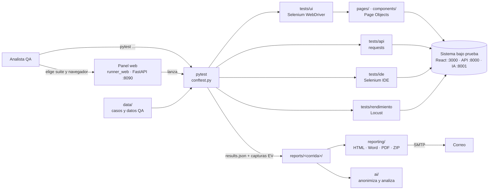

# Proyecto de Automatización · Testing, Quality Assurance

Automatización de pruebas del sistema **Fetal Medical Bolivia**, historia clínica gineco-obstétrica con análisis de
ecografías mediante redes neuronales (React + Django REST + PostgreSQL + microservicio de IA en FastAPI).

Universidad Privada Franz Tamayo · Ingeniería de Sistemas · Materia: Testing, Quality Assurance ·
Docente: Reynel Sánchez Chuquimia · Estudiante: Miguel Mirkof Becerra Guzmán

| | |
|---|---|
| Lenguaje | Python 3.12 (todo el código de la solución) |
| Framework principal | Selenium WebDriver 4.52 + pytest 9.2, patrón Page Object Model |
| Selenium IDE | 35 proyectos `.side`, reproducidos con selenium-side-runner 4.0.13 |
| API | pytest + requests |
| Rendimiento | Locust 2.47 |
| Ejecución | Panel web propio (FastAPI) o línea de comandos |
| Reportes | HTML, Word, PDF y ZIP con evidencias `EV-<caso>-<paso>-<fecha>`; envío por correo |
| IA (valor agregado) | Ollama local o Claude, con texto anonimizado; nunca decide un PASS o FAIL |
| Documento final | [`capitulo6/entregables/`](capitulo6/entregables/) · Capítulo 6, Estrategia y ejecución de pruebas (Word y PDF) |

## Resultados de la regresión final

Corrida `20261115-091110` sobre el sistema en marcha, con las cinco cuentas reales de la clínica y datos sintéticos.

| Suite | Pruebas | PASS | FAIL | NOT RUN |
|---|---:|---:|---:|---:|
| API (pytest + requests) | 460 | 460 | 0 | 0 |
| Interfaz (Selenium WebDriver) | 73 | 72 | 0 | 1 |
| Selenium IDE | 35 | 35 | 0 | 0 |
| Rendimiento (Locust) | 4 | 1 | 0 | 3 |
| **Total** | **572** | **568** | **0** | **4** |

- **Porcentaje de salud:** 100 % (PASS sobre pruebas ejecutadas).
- **Casos de prueba:** 172 diseñados, 145 seleccionados para automatizar, 145 automatizados (100 %).
- **Por herramienta:** 54 API, 52 Selenium WebDriver, 35 Selenium IDE, 4 Locust y 27 verificados con la suite del sistema.
- **Carga (TC-112):** 40 usuarios durante 3 minutos, 3 352 peticiones, p95 de 89 ms y 0 % de errores.
- **Defectos:** 8 encontrados por la automatización; 7 corregidos y verificados, 1 de severidad baja abierto con propuesta.
- **NOT RUN:** estrés, pico y resistencia (requieren autorización porque pueden saturar el equipo) y el primer
  ingreso del médico (su doble factor ya está configurado).

## Arquitectura



Flujo de una corrida: selección de la suite → sesión por rol y datos sintéticos QA → ejecución → aserciones →
capturas de evidencia → `results.json` → reportes → (IA) → correo → limpieza de los datos QA.

## Estructura

```
├── config/config.yaml        configuración no secreta (URL, navegador, esperas)
├── .env.example              variables con valores ficticios (el .env real no se versiona)
├── conftest.py               fixtures por rol, resultados por caso y evidencias
├── pytest.ini                marcadores: smoke, regression, roles, busqueda, ide, rendimiento, ...
├── pages/                    Page Objects: base, login, pacientes, formularios clínicos, pantalla genérica
├── components/               menú lateral
├── tests/
│   ├── api/                  autenticación, permisos por rol, pacientes, historia clínica, citas, IA, robustez
│   ├── ui/                   autenticación, pacientes, flujo clínico, roles, buscadores, barrido de pantallas
│   ├── ide/                  reproduce los 35 proyectos de Selenium IDE
│   └── rendimiento/          Locust: carga, estrés, pico y resistencia
├── selenium_ide/             un .side por caso y FetalMedical_SeleniumIDE.side con una suite por módulo
├── locust/locustfile.py      usuarios virtuales por rol (solo lecturas)
├── data/                     catálogo de casos, fábrica de datos, defectos, listados, ecografías de prueba
├── utils/                    configuración, navegador, cliente de la API, TOTP, evidencias
├── reporting/                reportes HTML, Word, PDF, ZIP y correo
├── ai/                       anonimizador, proveedores (Ollama, Claude) y tareas
├── runner_web/               panel web de ejecución
├── tools/                    inventario, explorador, generador y ejecutor de Selenium IDE, limpieza de datos QA
└── capitulo6/                generador del Capítulo 6 y documento final (entregables/)
```

## Localizadores y validaciones

| Tipo | Selenium WebDriver | Selenium IDE |
|---|---|---|
| ID | `By.ID, "email"`, `"totp_code"`, `"fecha_ultima_menstruacion"` | `id=email`, `id=nombre` |
| Name | `By.NAME, "file"` (carga de la ecografía) | — |
| XPath | `//button[.//span[normalize-space(.)='Buscar']]` | `xpath=//tr[contains(@class,'ant-table-row')][contains(.,'${termino}')]` |
| CSS Selector | `input[placeholder='Buscar por nombre, CI o ID...']` | `css=.ant-table-tbody tr.ant-table-row` |
| Validaciones | `assert` con mensaje en cada prueba | `assert`, `assertText`, `assertValue`, `assertElementPresent`, `assertElementNotPresent`, `assertTitle`, `verifyElementPresent` |

El caso **TC-171** (`tests/ui/test_buscadores_ui.py`) reúne los cuatro tipos de localizador en un flujo: inicio de
sesión con doble factor, carga de una ecografía y análisis con IA, con sus validaciones y tres capturas.

## Requisitos

- Windows 10/11, Python 3.12 y Google Chrome (Edge y Firefox opcionales). Selenium Manager descarga el driver.
- Node.js 18 o superior, solo para reproducir los proyectos de Selenium IDE.
- Microsoft Word, solo para el PDF del reporte.
- El sistema Fetal Medical en marcha (interfaz en `http://localhost:3000`, API en `http://localhost:8000`).

## Instalación

```bat
python -m venv .venv
.venv\Scripts\python -m pip install -r requirements.txt
copy .env.example .env
```

Complete `.env`: la clave de las cuentas de prueba, la clave TOTP de las cuentas con doble factor, el usuario y la
clave del panel y, para el correo, una **contraseña de aplicación** de Gmail. El `.env` nunca se sube al repositorio.

## Ejecución

### Panel web

```bat
EJECUTAR_PANEL.bat
```

Abre `http://127.0.0.1:8090`: se elige la suite y el navegador, se ve el registro en vivo, se puede cancelar y al
terminar se descargan los reportes desde el historial.

### Línea de comandos

```bat
.venv\Scripts\python -m pytest -m smoke                      :: humo
.venv\Scripts\python -m pytest tests\api                     :: API completa
.venv\Scripts\python -m pytest tests\ui -m "not regression"  :: interfaz sin el barrido de pantallas
.venv\Scripts\python -m pytest -m busqueda                   :: buscadores y filtros de los 17 listados
.venv\Scripts\python -m pytest -k tc171 --visible            :: localizadores ID, Name, XPath y CSS, a la vista
.venv\Scripts\python -m pytest tests\ide                     :: los 35 casos de Selenium IDE
.venv\Scripts\python -m pytest tests\rendimiento             :: carga con Locust (40 usuarios)
.venv\Scripts\python -m pytest                               :: todo
.venv\Scripts\python -m reporting.generar --correo           :: reportes y correo de la última corrida
```

Opciones: `--navegador chrome|edge|firefox`, `--visible` (muestra el navegador) y `--suite nombre`. Los resultados
quedan en `reports/<corrida>/`: `results.json`, `evidencias/`, `reporte.html`, `.docx`, `.pdf` y un ZIP.

Para abrir los casos en la extensión Selenium IDE: **Open project** → `selenium_ide/FetalMedical_SeleniumIDE.side`.
Las credenciales no están en los archivos: el ejecutor (`tools/ejecutar_side.py`) las toma de `.env`.

## Estados

| Estado | Significado |
|---|---|
| PASS | La aserción se cumplió |
| FAIL | La aserción no se cumplió (clasificación inicial: sistema, script, datos o ambiente) |
| BLOCKED | No se pudo ejecutar por una condición externa |
| NOT RUN | Definida pero no ejecutada |

## Datos y seguridad

- Solo datos sintéticos: nombres con el prefijo `QA` y cédulas que empiezan con 99. Al terminar, cada corrida da de
  baja a las pacientes QA y cancela sus citas (`tools\limpiar_qa.py` cubre las corridas canceladas).
- Ninguna contraseña, clave TOTP ni token está en el código, en las grabaciones ni en los reportes.
- La IA recibe solo texto anonimizado y cada uso queda registrado sin su contenido.

## Gitflow

| Rama | Uso |
|---|---|
| `main` | Versiones entregadas (etiqueta `v1.0.0`) |
| `develop` | Integración de las funcionalidades |
| `feature/*` | Una rama por funcionalidad, con su issue y su pull request hacia `develop` |
| `release/1.0.0` | Preparación de la entrega, unida a `main` y de vuelta a `develop` |
