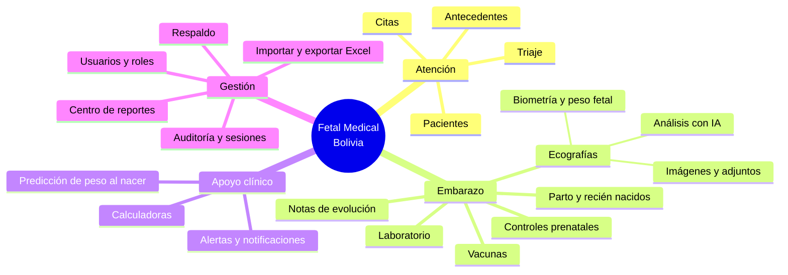

# 01 · Visión general

## Propósito

Dar a los servicios de ginecología y obstetricia una historia clínica digital
única que acompañe a la gestante desde su registro hasta el parto, con cálculos
clínicos confiables, apoyo de inteligencia artificial medido honestamente y
trazabilidad completa de quién hizo qué.

## Problema que resuelve

- Historias en papel o en planillas sueltas: datos repetidos, perdidos o
  ilegibles, y sin alertas.
- Cálculos hechos a mano (edad gestacional, peso fetal, riesgo de
  preeclampsia, diabetes gestacional) con errores frecuentes.
- Ningún registro de quién consultó o modificó los datos de una paciente.

## Alcance

Incluye: pacientes, antecedentes, embarazo, controles prenatales, ecografías
(biometría, imágenes, adjuntos, análisis con IA), laboratorio, vacunas, triaje,
citas, notas de evolución, parto y recién nacidos, calculadoras clínicas,
reportes, notificaciones, usuarios, roles y auditoría. Varias clínicas en una
misma instalación, cada una con sus datos separados.

No incluye: facturación, farmacia, internación general ni integración con el
SUS / SNIS (prevista como trabajo futuro).

## Roles

| Rol | Qué hace | Qué no ve |
|---|---|---|
| Recepción | Registra pacientes, agenda citas | Información clínica (ecografías, laboratorio, IA) |
| Enfermería | Triaje, signos vitales, controles, vacunas | Partos y reportes |
| Médico/a | Embarazo, controles, ecografías e IA, parto, notas, laboratorio, reportes | Configuración del sistema |
| Laboratorio | Carga y valida resultados de exámenes | Resto de la historia |
| Administrador/a | Usuarios, roles, auditoría, importaciones, reportes, respaldo | — |
| Sistema | Recordatorios, alertas, cálculos automáticos | — |

## Módulos

## Glosario

| Término | Significado |
|---|---|
| FUM | Fecha de la última menstruación |
| FPP | Fecha probable de parto |
| EG | Edad gestacional (semanas + días) |
| DBP, CC, CA, LF | Diámetro biparietal, circunferencia cefálica, circunferencia abdominal, longitud femoral (mm) |
| Hadlock | Fórmula que estima el peso fetal a partir de la biometría |
| ILA | Índice de líquido amniótico |
| PTOG | Prueba de tolerancia oral a la glucosa (75 g) |
| IADPSG | Criterio de diagnóstico de diabetes gestacional que usa la norma boliviana |
| Apgar | Puntaje de vitalidad del recién nacido al minuto, 5 y 10 minutos |
| Tenant / clínica | Cada clínica es un esquema separado de la base de datos |
| Ley 164 | Ley boliviana de telecomunicaciones y TIC; exige consentimiento para tratar datos personales |
