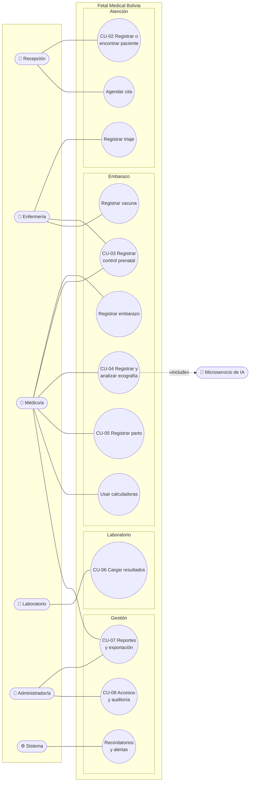
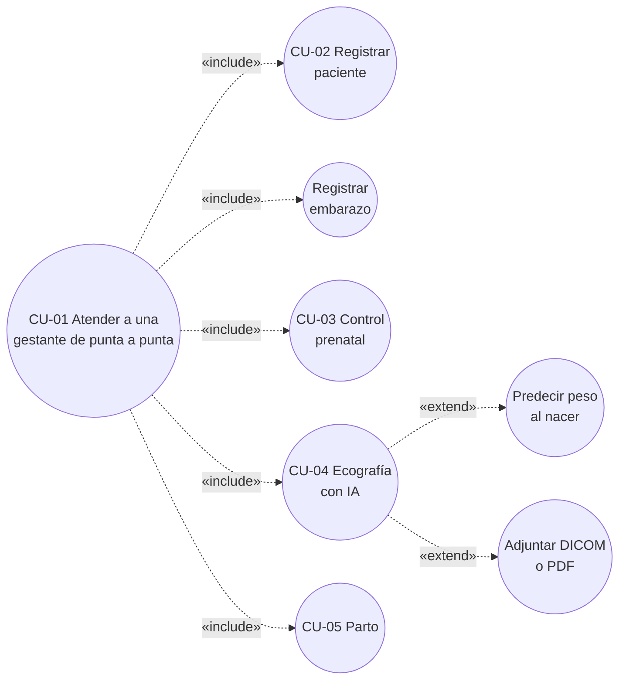

# 05 · Casos de uso

## Diagrama de casos de uso

Mermaid no tiene diagramas UML de casos de uso; se representan con actores
(izquierda), el límite del sistema (recuadros por área) y los casos de uso
(óvalos).

El caso de uso CU-01 recorre la atención completa e incluye a los demás:

## CU-01 · Atender a una gestante de punta a punta

| | |
|---|---|
| Actores | Recepción, Médico/a, Sistema, Microservicio de IA |
| Precondición | Sistema en marcha; usuarios con sesión iniciada |
| Postcondición | Historia clínica completa y auditada |
| Requisitos | RF-01, RF-05, RF-06, RF-07, RF-09, RF-11 |
| Casos de prueba | CP-001, CP-021, CP-032, CP-041 (flujo E2E en el navegador) |

**Flujo principal**
1. Recepción registra a la paciente con su consentimiento.
2. El médico inicia el embarazo desde la historia clínica (FUM; gesta calculada).
3. Registra el control prenatal; el sistema calcula la EG y marca las alertas.
4. Registra la ecografía con su biometría y sube la imagen.
5. Analiza la imagen con las redes medidas (plano, cabeza, anomalías cerebrales).
6. Al terminar la gestación registra el parto, que llega con el embarazo elegido.

**Flujos alternativos**
- 1a. Sin consentimiento: no se guarda y se indica por qué.
- 5a. Microservicio de IA apagado: aviso claro; el resto del registro sigue.

## CU-02 · Registrar o encontrar a una paciente

| | |
|---|---|
| Actores | Recepción |
| Precondición | Sesión de recepción iniciada |
| Postcondición | Paciente única, registrada con consentimiento |
| Requisitos | RF-01, RF-02, RF-03 |
| Casos de prueba | CP-001, CP-002, CP-003 |

**Flujo principal**
1. Busca por nombre, apellido o CI.
2. Si no existe, abre el asistente de registro y completa los datos.
3. Marca el consentimiento y guarda.
4. El sistema asigna el ID clínico y ofrece registrar el embarazo.

**Flujos alternativos**
- 1a. Escribe sin tilde u otra grafía: igual la encuentra.
- 3a. CI ya registrada: se rechaza el duplicado.
- 2b. Carga masiva: importa un Excel con vista previa (RF-03).

## CU-03 · Registrar un control prenatal

| | |
|---|---|
| Actores | Médico/a, Enfermería |
| Precondición | La paciente tiene un embarazo activo |
| Postcondición | Control registrado con sus alertas |
| Requisitos | RF-06 |
| Casos de prueba | CP-020, CP-021 |

**Flujo principal**
1. Elige a la paciente; el embarazo activo se completa solo.
2. Ingresa peso, PA, altura uterina, FCF, edema y proteinuria.
3. El sistema calcula la edad gestacional y las alertas.
4. Guarda; el control aparece en la línea de tiempo del embarazo.

**Flujos alternativos**
- 3a. PA ≥ 140/90 o FCF anormal: el control queda marcado con alerta y se notifica.

## CU-04 · Registrar y analizar una ecografía

| | |
|---|---|
| Actores | Médico/a, Sistema, Microservicio de IA |
| Precondición | Embarazo activo |
| Postcondición | Ecografía con biometría, imágenes, adjuntos y análisis guardados |
| Requisitos | RF-07, RF-08, RF-09, RF-10 |
| Casos de prueba | CP-030, CP-032, CP-033, CP-036, CP-037 |

**Flujo principal**
1. Registra la ecografía con su biometría (el tipo se sugiere según la EG).
2. El sistema estima el peso fetal con Hadlock.
3. Sube la imagen o adjunta un DICOM / PDF.
4. Pide el análisis con las redes medidas.
5. Opcional: estima el peso al nacer con el modelo supervisado.

**Flujos alternativos**
- 2a. Falta una medida: el peso no se estima (nunca se muestra 0).
- 4a. La imagen no parece una cabeza: la red de anomalías no la clasifica y lo explica.
- 5a. Sin modelo entrenado, embarazo múltiple o menos de 20 semanas: se explica por qué no hay predicción.

## CU-05 · Registrar un parto

| | |
|---|---|
| Actores | Médico/a |
| Precondición | Embarazo activo |
| Postcondición | Parto con todos sus recién nacidos; embarazo finalizado |
| Requisitos | RF-11 |
| Casos de prueba | CP-040, CP-041 |

**Flujo principal**
1. Abre «nuevo parto» desde el embarazo (paciente y semanas ya completas).
2. Registra tipo de parto, presentación y datos maternos.
3. Agrega uno o varios recién nacidos con peso, talla, perímetro cefálico y Apgar.
4. Guarda; el embarazo pasa a «finalizado».

**Flujos alternativos**
- 3a. Un recién nacido con datos imposibles: no se guarda nada.

## CU-06 · Cargar resultados de laboratorio

| | |
|---|---|
| Actores | Laboratorio |
| Precondición | Catálogo de exámenes cargado |
| Postcondición | Resultados guardados y evaluados; importación auditada |
| Requisitos | RF-12, RF-13 |
| Casos de prueba | CP-050, CP-051, CP-053 |

**Flujo principal**
1. Descarga la plantilla, que trae el catálogo de parámetros y rangos.
2. La llena (una fila por parámetro) y la sube.
3. Revisa la vista previa con los errores de cada fila.
4. Confirma; el sistema crea los exámenes y evalúa cada valor.

**Flujos alternativos**
- 3a. CI inexistente, código o parámetro desconocido, fecha futura: la fila no se guarda y se explica.
- 4a. Archivo ya importado: los parámetros cargados se omiten.

## CU-07 · Consultar reportes y exportar

| | |
|---|---|
| Actores | Administrador/a, Médico/a |
| Precondición | Usuario con permiso de reportes |
| Postcondición | Reporte consultado; exportación auditada |
| Requisitos | RF-18, RF-19 |
| Casos de prueba | CP-105, CP-106 |

**Flujo principal**
1. Abre el centro de reportes.
2. Elige la pestaña (tiempo real, estadísticas por fecha, KPIs, indicadores, PDF, auditoría).
3. Filtra por fechas.
4. Exporta a Excel o genera el PDF.

**Flujos alternativos**
- 2a. Su rol no tiene una pestaña: no se le muestra.

## CU-08 · Gestionar accesos y auditar

| | |
|---|---|
| Actores | Administrador/a |
| Precondición | Sesión de administrador |
| Postcondición | Accesos según rol y trazabilidad completa |
| Requisitos | RF-21, RF-22 |
| Casos de prueba | CP-090, CP-091, CP-092 |

**Flujo principal**
1. Crea un usuario y le asigna un rol.
2. El sistema le da automáticamente los permisos del rol.
3. Revisa las sesiones (inicio, fin, IP, navegador) y las acciones auditadas.

**Flujos alternativos**
- 1a. Cambia el rol de un usuario: cambian sus permisos.
- 3a. Un usuario con historial de auditoría no se borra: se desactiva.
