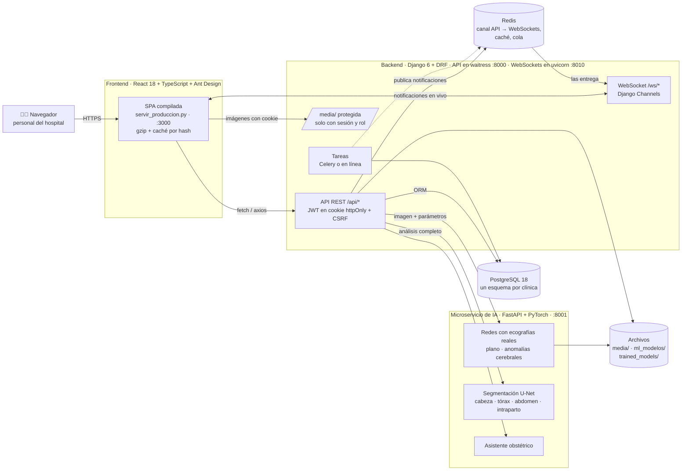
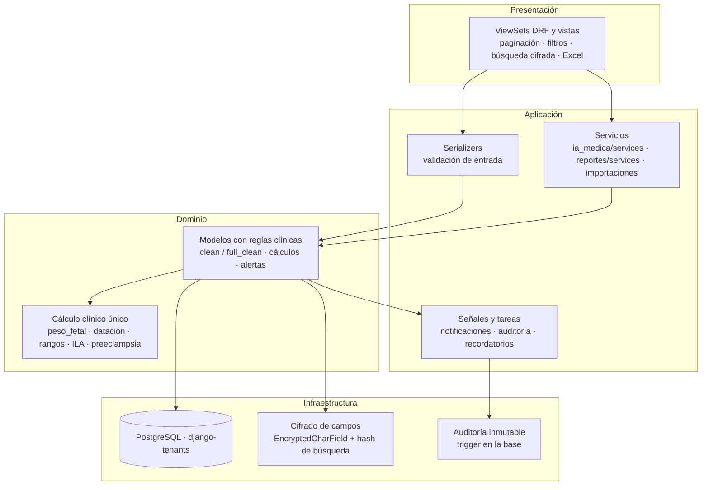
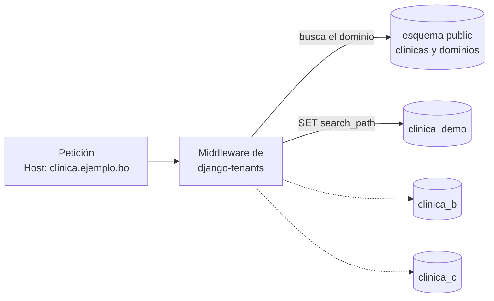

# 06 · Arquitectura

## Vista general (microservicios)

Tres servicios independientes que se comunican por HTTP, más la base de datos.
El frontend nunca habla directamente con el microservicio de IA: todo pasa por
el backend, que aplica permisos, auditoría y traduce los errores.

## Capas del backend

## Multi-clínica (tenants)

Cada clínica es un esquema de PostgreSQL. El dominio con el que se entra
(`localhost`, la IP del servidor o el dominio de la clínica) decide el
esquema. Las tablas de clínicas y dominios están en el esquema `public`.

## Módulos del backend (apps de Django)

| Área | Apps |
|---|---|
| Núcleo y seguridad | `core` (permisos, paginación, filtros, exportación, media protegida, validación de archivos), `usuarios`, `roles`, `auditoria`, `clientes` (clínicas) |
| Atención | `pacientes`, `antecedentes`, `citas`, `triaje`, `consultorios` |
| Embarazo | `embarazos`, `controles`, `ecografias`, `ecografias_archivos`, `laboratorio`, `vacunas`, `notas_evolucion`, `evoluciones` (solo lectura, histórico), `partos` |
| Apoyo clínico | `calculadoras`, `calculadoras_avanzadas`, `ia_medica` (puente con la IA y modelo supervisado) |
| Gestión | `reportes`, `notificaciones`, `soporte` |

## Frontend

| Carpeta | Contenido |
|---|---|
| `src/pages/` | Una carpeta por módulo (Pacientes, Embarazos, Controles, Ecografias, Partos, Laboratorio, Vacunas, Triaje, NotasEvolucion, Calculadoras, Reportes, IaMedica, HistoriaClinica…) |
| `src/services/` | Clientes de la API por módulo |
| `src/hooks/useListadoServidor.ts` | Listados paginados en el servidor (búsqueda, filtros, orden) |
| `src/utils/` | Cálculos clínicos compartidos con el backend (peso fetal, diabetes gestacional, ILA, preeclampsia) |
| `src/routes/` | Rutas con permisos y carga diferida por página |

## Tecnologías

| Capa | Tecnología |
|---|---|
| Frontend | React 18, TypeScript, Ant Design 5, Recharts, Day.js |
| Backend | Python 3.12, Django 6, Django REST Framework, django-tenants, Channels, SimpleJWT, drf-spectacular (OpenAPI) |
| IA | FastAPI, PyTorch (CUDA), timm (EfficientNet), scikit-learn (modelo supervisado) |
| Base de datos y mensajería | PostgreSQL 18; Redis (canal de notificaciones entre la API y los WebSockets, caché) |
| Opcionales | Celery, HashiCorp Vault (secretos), nginx (TLS) |
| Pruebas | pytest, Jest, Playwright, ruff, eslint, tsc |
