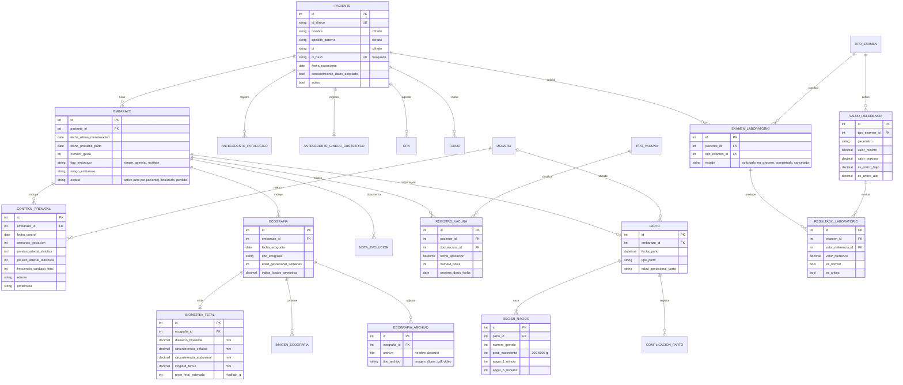
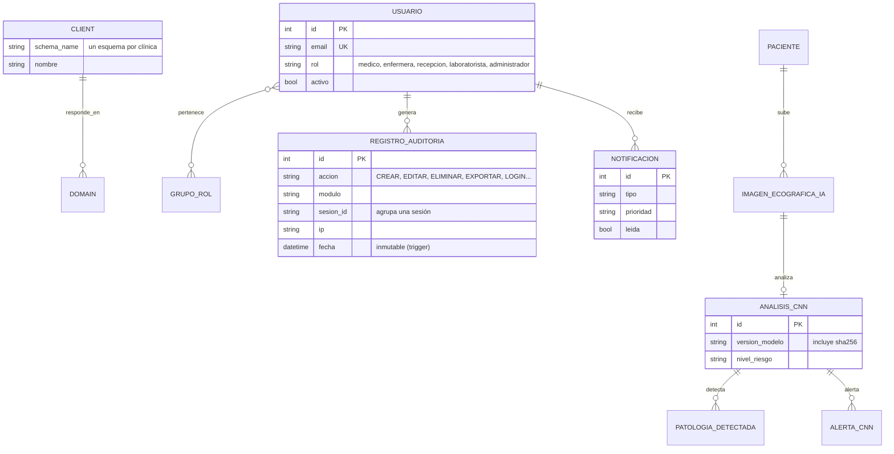

# 07 · Modelo de datos

Entidades principales de cada clínica (esquema propio en PostgreSQL). Se
muestran solo los campos que explican el modelo; cada tabla tiene además
fechas de creación/modificación y quién las hizo. Los campos marcados
«cifrado» se guardan cifrados (EncryptedCharField); la CI se busca por su hash.

## Núcleo clínico

Reglas importantes que impone la base o el modelo:

- **Un solo embarazo activo por paciente** (restricción única condicional).
- **La historia clínica no se borra en cascada**: las relaciones clínicas usan
  `PROTECT`; borrar un embarazo con ecografías responde 409.
- **Cada recién nacido se valida** (`full_clean`) y un parto múltiple se guarda
  entero o nada (transacción).
- **El resultado de laboratorio se evalúa al guardarse** contra su rango.

## Usuarios, auditoría e IA

