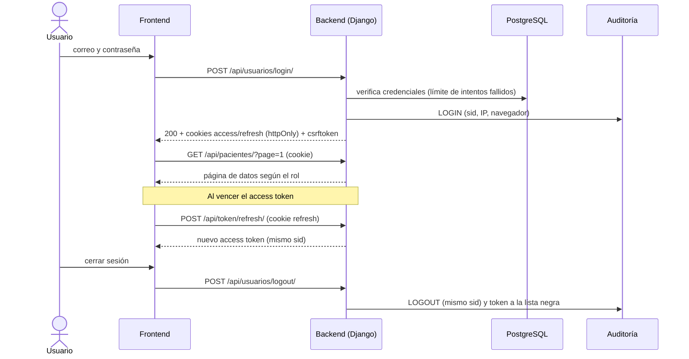
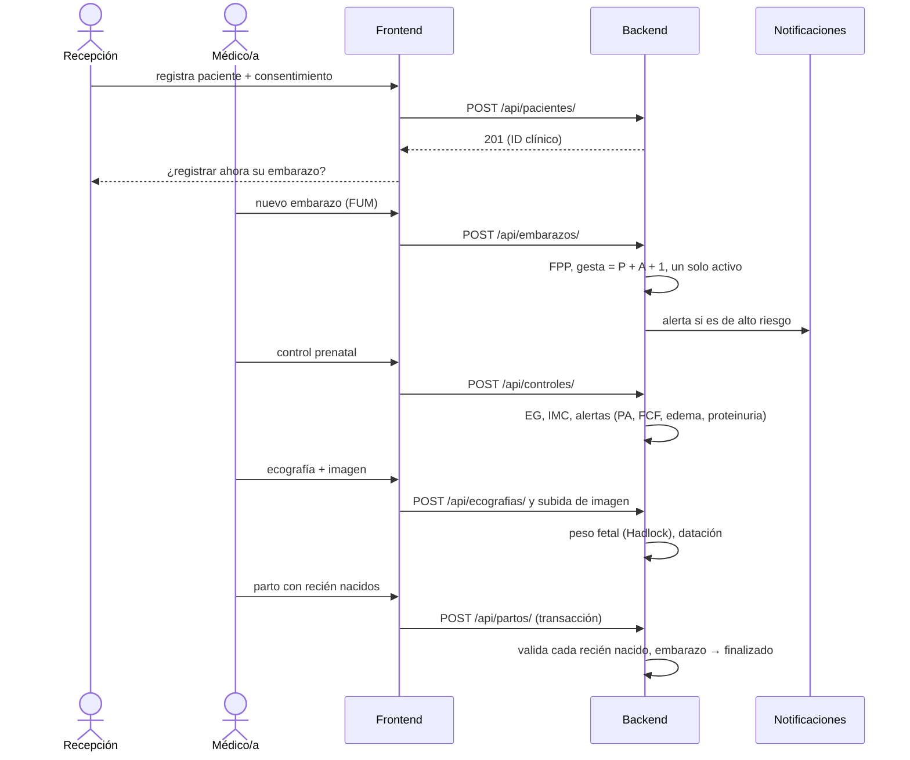
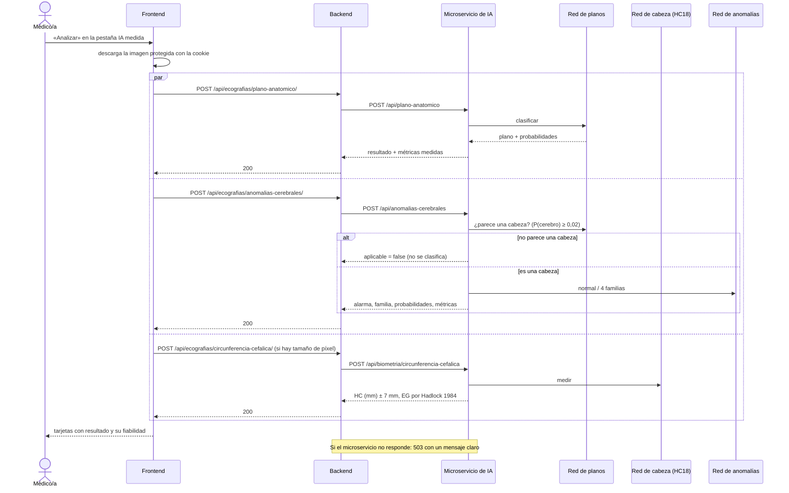
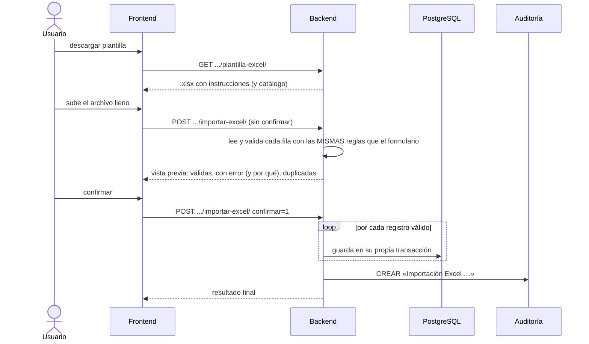
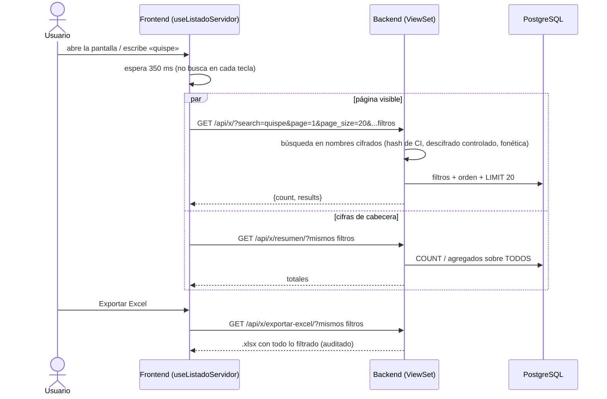
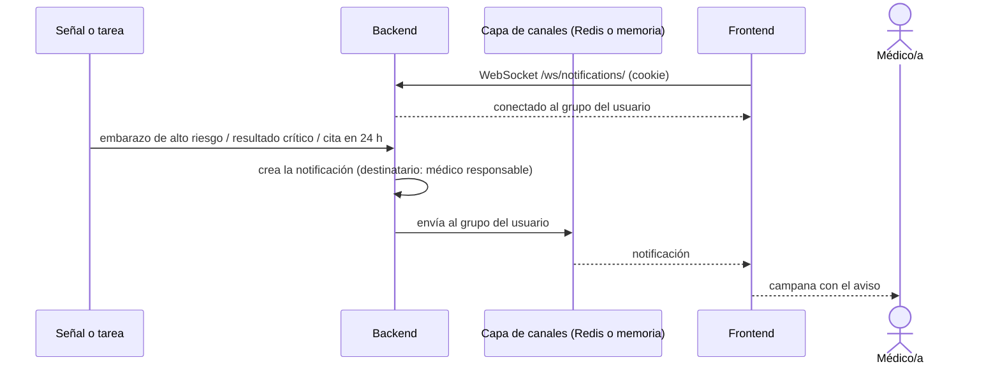

# 08 · Diagramas de secuencia

## Inicio de sesión y llamadas autenticadas

El token JWT viaja en una cookie `httpOnly` (el JavaScript no lo puede leer) y
las escrituras llevan el token CSRF. Cada sesión tiene un identificador `sid`
que agrupa sus registros de auditoría.

## Atención de una gestante (flujo principal)

## Análisis de una ecografía con las redes medidas

## Importación desde Excel (pacientes o resultados de laboratorio)

## Listado paginado en el servidor

## Notificaciones en tiempo real

