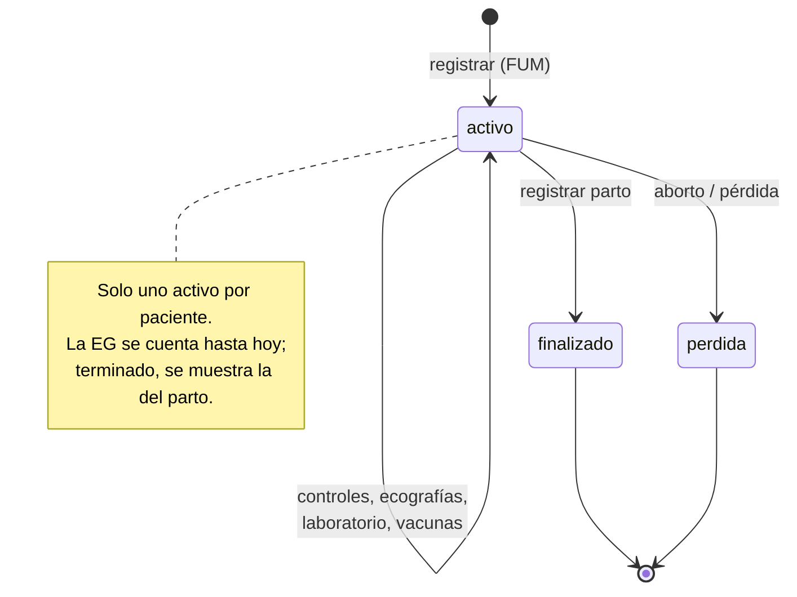
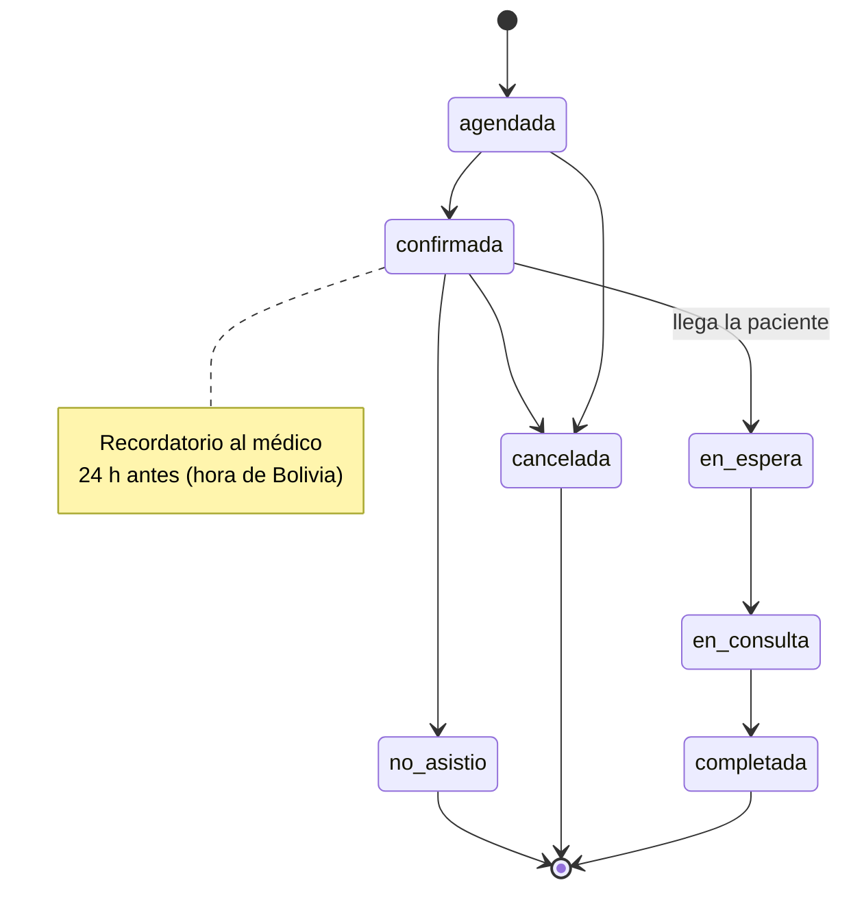
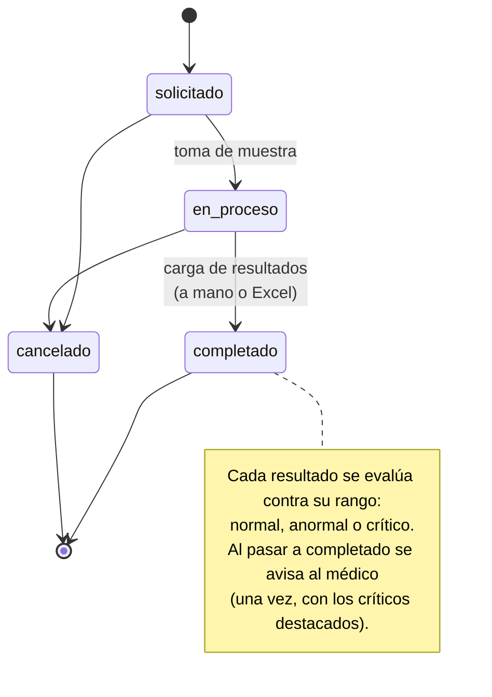
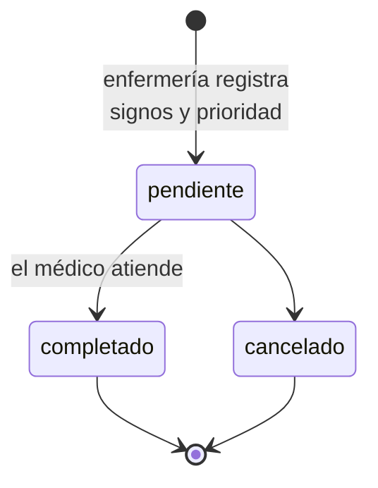
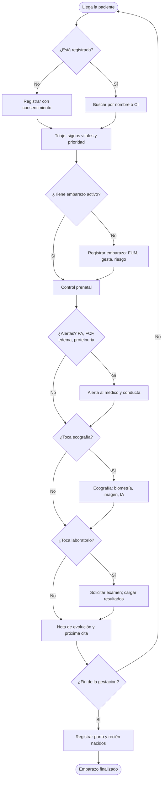
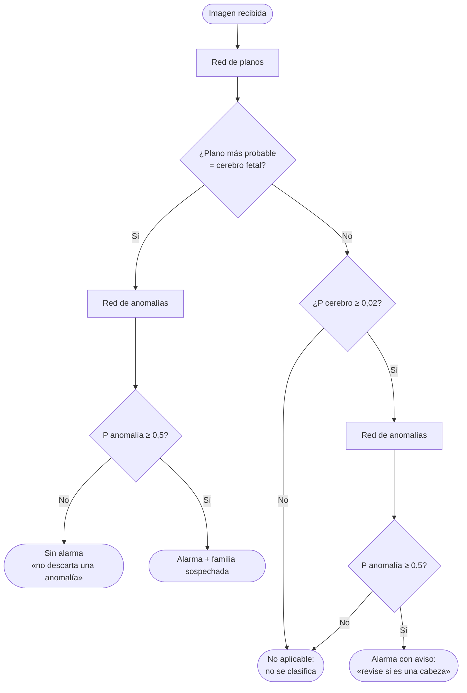

# 09 · Diagramas de estados y de actividad

## Embarazo

## Cita

## Examen de laboratorio

## Triaje

## Actividad: atención prenatal

## Actividad: decisión de la red de anomalías cerebrales

