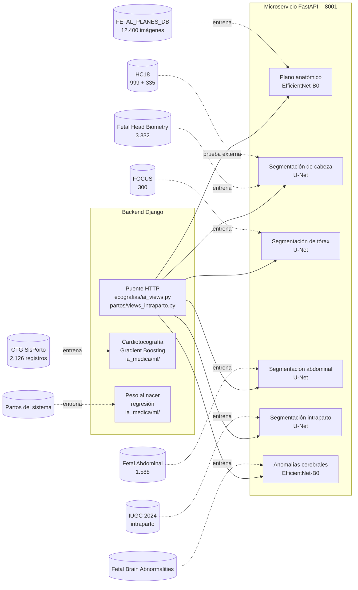
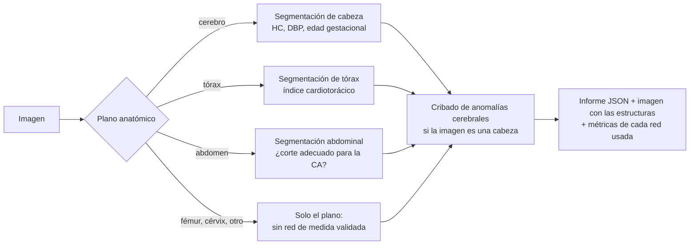
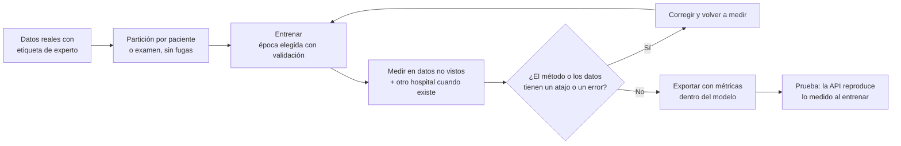

# 10 · Inteligencia artificial

Principio: **la IA apoya, no diagnostica**. Cada resultado viaja con las
métricas medidas en datos que el modelo no vio al entrenar, las pruebas
comprueban que la API reproduce lo medido al entrenar, y si no hay modelo el
sistema lo dice en lugar de inventar un número.

## Componentes

## Flujo del análisis de una ecografía

## Modelos y métricas medidas

| Modelo | Tarea | Datos | Métrica en datos no vistos | Estado |
|---|---|---|---|---|
| Plano anatómico | 6 clases | FETAL_PLANES_DB (Zenodo 3904280) | 92,7 % de exactitud en 5.271 imágenes de 896 madres; 93,1 % de cabezas de otro hospital | En uso |
| Segmentación de cabeza | Cráneo, cavum, ventrículo → HC, DBP, EG | Large-Scale Fetal Head Biometry (Zenodo 8265464) | Dice cráneo 0,968. **Otro hospital (HC18, 999 imágenes)**: HC con error medio 4,4 mm (3,7 %), 92 % dentro del 5 %, R² 0,982 | En uso |
| Segmentación de tórax | Tórax y corazón → índice cardiotorácico | FOCUS (Zenodo 14597550) | Dice 0,93; índice ±0,02. Solo corazones normales: mide, no valida la detección de cardiomegalia | En uso |
| Segmentación abdominal | Hígado, estómago, vena umbilical, aorta | Fetal Abdominal Structures (Mendeley) | Dice 0,69–0,84; estómago visto en el 92 %, vena en el 98 % | En uso |
| Segmentación intraparto | Sínfisis del pubis y cabeza → ángulo de progresión | IUGC MICCAI 2024 | 300 imágenes de 240 exámenes de otros años: error medio 6,7° (piso del método 3,4°); AoP ≥ 120°: sensibilidad 65 %, especificidad 96 % → se informa como medida | En uso |
| Anomalías cerebrales | Normal + 4 familias | Fetal Brain Abnormalities + normales de FETAL_PLANES | Falsas alarmas: 1 de 1.866 cabezas de otro hospital. **Sensibilidad real no medible** con datos públicos | Cribado de apoyo |
| Circunferencia cefálica (regresión) | HC en mm | HC18 | R² 0,978; error 7,0 mm (la segmentación la supera: 4,1 mm en las mismas imágenes) | Disponible |
| Cardiotocografía (supervisado) | Normal / sospechosa / patológica | 2.126 CTG reales, consenso de 3 obstetras | 96,0 % de exactitud (IC95 94,1–97,6 %) en 423 registros; patológica detectada en el 94,3 % | En uso |
| Peso al nacer (supervisado) | Regresión (g) + clase | Partos simulados del sistema | Error 183 g frente a 297 g de Hadlock; cada predicción se cierra con el peso real | Demostración: hay que reentrenarlo con partos reales |
| ~~EfficientNet-B4 «14 patologías»~~ | — | Etiquetas no verificables | Sin métrica válida | **Retirada el 01/10/2026** |

Detalles: `Backend/Microservicio_IA/README.md`, `datos/CATALOGO.md`,
`entrenamiento/segmentacion/salidas/<tarea>/metricas.json`,
`entrenamiento/patologias_cerebrales/INFORME.md` e `ia_medica/ml/cardiotocografia.py`.

## Entrenamiento honesto

Ejemplos de lo que este ciclo encontró y corrigió: la red de anomalías
reconocía la fuente de las imágenes en vez de la anomalía; el ángulo de
progresión se calculaba con el vértice equivocado cuando la cabeza ya había
descendido (sensibilidad 1 de 23 → 15 de 23); la B4 se retiró porque sus
etiquetas no eran verificables.

## Modelos supervisados del backend

- **Cardiotocografía**: compara regresión logística, Random Forest y Gradient
  Boosting con 11 y 21 variables por validación cruzada estratificada; elige
  por F1 macro y mide una sola vez en el 20 % reservado. Se niega a guardar un
  modelo que no detecte el 80 % de las patológicas. Comando:
  `entrenar_modelo_ctg`.
- **Peso al nacer**: variables de la ecografía y la madre; se niega a predecir
  en embarazos múltiples o antes de las 20 semanas. Comandos:
  `construir_dataset_peso`, `entrenar_modelo_peso`, `cerrar_predicciones_peso`.
