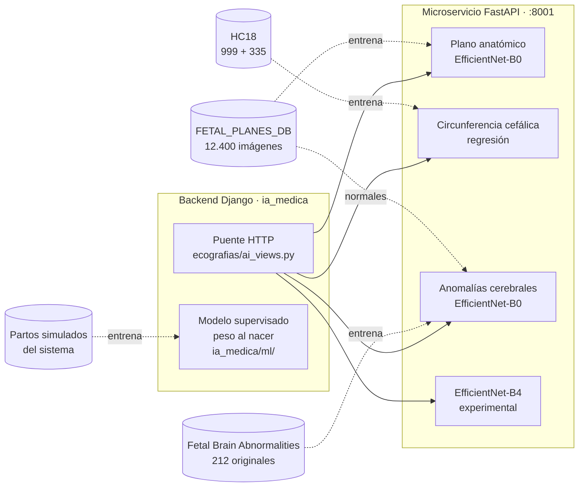
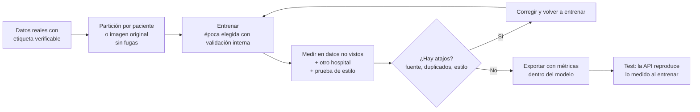

# 10 · Inteligencia artificial

Principio: **la IA apoya, no diagnostica**. Cada resultado viaja con las
métricas medidas en datos que el modelo no vio al entrenar, y si no hay
modelo el sistema lo dice en lugar de inventar un número.

## Componentes

## Modelos y métricas medidas

| Modelo | Tarea | Datos | Métrica en datos no vistos | Estado |
|---|---|---|---|---|
| Plano anatómico | 6 clases (abdomen, cerebro, fémur, tórax, cérvix, otro) | FETAL_PLANES_DB (Zenodo 3904280) | 92,7 % de exactitud en 5.271 imágenes de 896 madres; 93,1 % de cabezas de otro hospital | En uso |
| Circunferencia cefálica | Regresión (mm) + EG por Hadlock 1984 | HC18 (Zenodo 1327317) | R² 0,978; error medio 7,0 mm en 146 imágenes de 117 madres | En uso |
| Anomalías cerebrales | Normal + 4 familias | Fetal Brain Abnormalities + normales de FETAL_PLANES | Falsas alarmas: 0,2 % en 999 cabezas de otro hospital; 0,4 % en 3.199 imágenes que no son cabezas. **Sensibilidad real no medible** con datos públicos | Cribado de apoyo |
| Peso al nacer (supervisado) | Regresión (g) + clase | Partos simulados del sistema (513) | Ridge: error medio 183 g frente a 297 g de Hadlock; R² 0,836 | Demostración: hay que reentrenarlo con partos reales |
| EfficientNet-B4 | 14 patologías | Datasets con etiquetas no verificables | Sin métrica válida | Experimental, marcada en pantalla |

Detalles y límites: `Backend/Microservicio_IA/entrenamiento/patologias_cerebrales/INFORME.md`,
`Backend/Microservicio_IA/entrenamiento/redes_ecografia_real/LEEME.md` y
`Backend/Microservicio_IA/datos/CATALOGO.md`.

## Entrenamiento honesto

## Modelo supervisado de peso al nacer

- Variables: biometría de la ecografía (DBP, CC, CA, LF), semanas en la
  ecografía y semana objetivo del parto, datos maternos y antecedentes.
- Se comparan Hadlock proyectado, Ridge, Random Forest y Gradient Boosting con
  partición por paciente; se guarda el que mejora significativamente a Hadlock.
- Se niega a predecir en embarazos múltiples, ecografías de menos de 20
  semanas o si las variables del modelo no coinciden con las actuales.
- Comandos: `construir_dataset_peso`, `entrenar_modelo_peso`.
