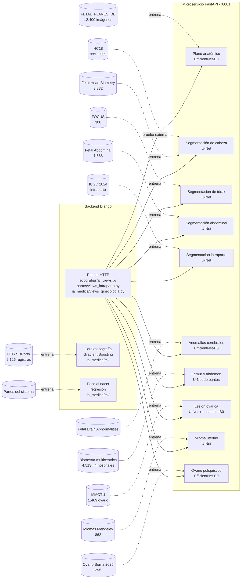
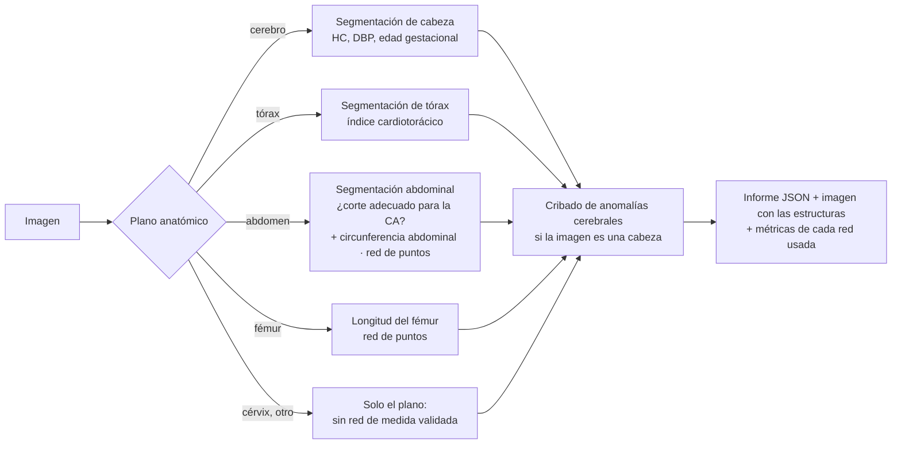
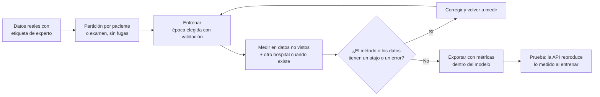

# 10 · Inteligencia artificial

Principio: **la IA apoya, no diagnostica**. Cada resultado viaja con las
métricas medidas en datos que el modelo no vio al entrenar, las pruebas
comprueban que la API reproduce lo medido al entrenar, y si no hay modelo el
sistema lo dice en lugar de inventar un número.

## Componentes

## Flujo del análisis de una ecografía

## Modelos y métricas medidas

| Modelo | Tarea | Datos | Métrica en datos no vistos | Estado |
|---|---|---|---|---|
| Plano anatómico | 6 clases | FETAL_PLANES_DB (Zenodo 3904280) | 92,7 % de exactitud en 5.271 imágenes de 896 madres; 93,1 % de cabezas de otro hospital | En uso |
| Segmentación de cabeza | Cráneo, cavum, ventrículo → HC, DBP, EG | Large-Scale Fetal Head Biometry (Zenodo 8265464) | Dice cráneo 0,968. **Otro hospital (HC18, 999 imágenes)**: HC con error medio 4,4 mm (3,7 %), 92 % dentro del 5 %, R² 0,982 | En uso |
| Segmentación de tórax | Tórax y corazón → índice cardiotorácico | FOCUS (Zenodo 14597550) | Dice 0,93; índice ±0,02. Solo corazones normales: mide, no valida la detección de cardiomegalia | En uso |
| Segmentación abdominal | Hígado, estómago, vena umbilical, aorta | Fetal Abdominal Structures (Mendeley) | Dice 0,69–0,84; estómago visto en el 92 %, vena en el 98 % | En uso |
| Segmentación intraparto | Sínfisis del pubis y cabeza → ángulo de progresión | IUGC MICCAI 2024 | 300 imágenes de 240 exámenes de otros años: error medio 6,7° (piso del método 3,4°); AoP ≥ 120°: sensibilidad 65 %, especificidad 96 % → se informa como medida | En uso |
| Anomalías cerebrales | Normal + 4 familias | Fetal Brain Abnormalities + normales de FETAL_PLANES | Falsas alarmas: 1 de 1.866 cabezas de otro hospital. **Sensibilidad real no medible** con datos públicos | Cribado de apoyo |
| Circunferencia cefálica (regresión) | HC en mm | HC18 | R² 0,978; error 7,0 mm (la segmentación la supera: 4,1 mm en las mismas imágenes) | Disponible |
| Cardiotocografía (supervisado) | Normal / sospechosa / patológica | 2.126 CTG reales, consenso de 3 obstetras | 96,0 % de exactitud (IC95 94,1–97,6 %) en 423 registros; patológica detectada en el 94,3 % | En uso |
| Peso al nacer (supervisado) | Regresión (g) + clase | Partos simulados del sistema | Error 183 g frente a 297 g de Hadlock; cada predicción se cierra con el peso real | Demostración: hay que reentrenarlo con partos reales |
| Longitud del fémur (U-Net de puntos) | Extremos del fémur → LF | Multicentre Fetal Biometry 2026 (Barcelona, Londres) | Error medio 1,3 mm (mediana 0,6), 92 % dentro del 5 % en 353 imágenes de 271 pacientes | En servicio |
| Circunferencia abdominal (U-Net de puntos) | Diámetros transverso y anteroposterior → CA | ídem | Error relativo 2,9 % (mediana 2,9 mm), 89 % dentro del 5 % en 134 imágenes | En servicio |
| ~~Acidemia fetal desde el monitoreo~~ · ~~Parto prematuro desde el EHG~~ | Señales PhysioNet (CTU-UHB, TPEHG) | — | AUC 0,73 (especificidad 33 % para 90 % de sensibilidad) · sin señal (AUC 0,42–0,45 en validación) | **Evaluados y descartados** |
| Lesión ovárica (U-Net) | Contorno de la masa anexial | MMOTU (Beijing Shijitan Hospital, anatomía patológica) | Dice 0,85; lesión encontrada en el 88 % de 436 imágenes de la prueba por paciente | En servicio |
| Tipo de lesión ovárica | 8 clases + alarma de carcinoma seroso de alto grado | MMOTU | 68,6 % (IC 64–73), AUC 0,91; carcinoma: AUC 0,87, detecta 7 de 13 con 97,6 % de especificidad | En servicio como orientación; **sin alarma no descarta** |
| Mioma uterino (U-Net) | Ubicación del mioma | Mendeley n2zcmcypgb (788 pacientes) | Encontrado en el 96,9 % de 128 imágenes de 118 pacientes (IoU 0,78) | En servicio; no descarta |
| Ovario poliquístico | Normal / folículo dominante / poliquístico | Borna et al. 2025 (295 pacientes) | 80,0 % (IC 75–84), 5 pliegues | En servicio; SOP = Rotterdam |
| ~~Cáncer cervicouterino por factores de riesgo~~ · ~~Riesgo materno~~ | Tablas UCI | — | AUC 0,60 · 71 % balanceada | **Evaluados y descartados** (no superan la referencia) |
| ~~EfficientNet-B4 «14 patologías»~~ | — | Etiquetas no verificables | Sin métrica válida | **Retirada el 01/10/2026** |

Detalles: `Backend/Microservicio_IA/README.md`, `datos/CATALOGO.md`,
`entrenamiento/segmentacion/salidas/<tarea>/metricas.json`,
`entrenamiento/patologias_cerebrales/INFORME.md`, `entrenamiento/ginecologia/` e `ia_medica/ml/cardiotocografia.py`.

### Ginecología: cómo se midió

- **Auditoría antes de entrenar** (`auditar.py`): MMOTU prometía partición por paciente, pero 37 pares de casi copias la cruzaban y 5 pares tenían diagnósticos distintos; se excluyeron las contradictorias y de la prueba las casi copias de entrenamiento. El dataset de miomas traía el nombre de la paciente en el XML: se usa solo anonimizado para agrupar.
- **Elección sin mirar la prueba**: la variante del clasificador de ovario (imagen entera, recorte de la lesión, red más grande o ensamble) se eligió con la validación; en la prueba se informan todas las candidatas (`metricas_ronda2.json`). La red más grande no mejoró; el ensamble quedó igual que la primera: el límite son los datos (842 imágenes para 8 clases).
- **La API reproduce el entrenamiento**: `test_ginecologia.py` comprueba sobre 40 imágenes de prueba el mismo tipo y las mismas probabilidades (±0,02), y la misma caja del mioma (IoU ±0,02).
- **Lo que no se promete**: la alarma de carcinoma detectó 7 de 13 (no sirve como tamizaje: sin alarma no descarta); la red de miomas solo vio úteros con mioma; el SOP no se diagnostica por imagen. Los modelos en tabla de cáncer cervicouterino y riesgo materno no superaron la referencia y no se usan.

## Modelos por enfermedad (CIE-10)

Qué hace el sistema ante cada patología, con qué tipo de modelo y cuánto acierta
en pacientes que no vio. «Confiable» = medido contra el experto en datos no vistos
con un error clínicamente aceptable; «orientación» = útil como segunda opinión,
no para decidir; «no validado» = no hay datos públicos para medirlo.

### Obstetricia

| Enfermedad o situación | CIE-10 | Modelo y tipo | Confiabilidad medida | Estado |
|---|---|---|---|---|
| Edad gestacional (datación) | Z36 | U-Net de cabeza (CNN de segmentación) → CC y DBP → Hadlock | CC con 4,4 mm de error en otro hospital; 92 % dentro del 5 % | Confiable |
| Restricción del crecimiento / macrosomía | O36.5 · O36.6 | U-Net de cabeza + **U-Net de puntos** (fémur, abdomen) → peso fetal estimado con la fórmula de Hadlock y su percentil | Cada medida validada (CC 4,4 mm; LF 1,3 mm; CA 2,9 %). El peso estimado de punta a punta contra el peso al nacer real **no** está validado | Confiable por medida; el diagnóstico lo da el percentil clínico |
| Peso al nacer | — | Regresión supervisada (Ridge) | Entrenado con datos simulados: sin cifra clínica. Se valida solo con los partos reales del hospital | No validado |
| Malformaciones del sistema nervioso central | Q00–Q07 · O35.0 | Clasificador CNN (EfficientNet-B0) | Casi sin falsas alarmas (1 de 1.866); cuántas detecta **no se puede medir** con datos públicos | Orientación |
| Cardiomegalia / cardiopatía | Q20–Q28 | U-Net de tórax (índice cardiotorácico) | La medida ±0,02; la detección de la enfermedad no validada (solo corazones normales). Heartbeat y CARDIUM exigen solicitud institucional | Medida confiable; detección no validada |
| Sufrimiento fetal (monitoreo) | O68 · O36.3 | Gradient boosting supervisado sobre la cardiotocografía | 96,0 % (IC 94,1–97,6); 94 % de las patológicas detectadas | Confiable como segunda lectura |
| Acidemia al nacer desde la señal del monitoreo | P20 | Modelos supervisados sobre CTU-UHB | AUC 0,73: demasiadas falsas alarmas | **Descartado** |
| Trabajo de parto que no progresa | O62–O64 | U-Net intraparto → ángulo de progresión | 6,7° de error medio; con corte en 120° detecta el 65 % | Medida confiable; orientación para decidir |
| Parto prematuro | O60 | Modelos supervisados sobre el electrohisterograma (TPEHG) | Sin señal medida sin fugas | **Descartado**; la longitud cervical (ISBI 2025) exige acuerdo de datos |
| Preeclampsia · diabetes gestacional · trisomías | O14 · O24 · Q90 | Calculadoras clínicas (FMF, IADPSG): fórmulas, no IA | Las de la literatura | En uso (no es IA) |
| Calidad del plano anatómico | — | Clasificador CNN (EfficientNet-B0) | 92,7 % | Confiable |

### Ginecología

| Enfermedad | CIE-10 | Modelo y tipo | Confiabilidad medida | Estado |
|---|---|---|---|---|
| Masa anexial (contorno) | N83 · D27 · C56 | U-Net de segmentación | Lesión encontrada en el 88 %, Dice 0,85 | Confiable |
| Tipo de lesión ovárica (8 clases) | N83 · D27 | Ensamble de 2 CNN EfficientNet-B0 | 68,6 % (IC 64–73), AUC 0,91 | Orientación |
| Cáncer de ovario (carcinoma seroso de alto grado) | C56 | El mismo ensamble, alarma P ≥ 0,25 | Detecta 7 de 13 (54 %), especificidad 97,6 % | Orientación; **sin alarma no descarta** |
| Mioma uterino | D25 | U-Net de segmentación (cajas) | Ubicado en el 96,9 % | Confiable para ubicar; no para descartar |
| Ovario poliquístico | E28.2 | CNN EfficientNet-B0 | 80,0 % (IC 75–84) | Orientación (SOP = criterios de Rotterdam) |
| Cáncer cervicouterino por factores de riesgo | C53 | Modelos supervisados (UCI 383) | AUC 0,60; con tamizaje no supera la regla «alguna prueba positiva» | **Descartado** |
| Riesgo materno general | — | Modelos supervisados (UCI 863) | 71 % balanceada, etiqueta sin criterio | **Descartado** |

## Entrenamiento honesto

Ejemplos de lo que este ciclo encontró y corrigió: la red de anomalías
reconocía la fuente de las imágenes en vez de la anomalía; el ángulo de
progresión se calculaba con el vértice equivocado cuando la cabeza ya había
descendido (sensibilidad 1 de 23 → 15 de 23); la B4 se retiró porque sus
etiquetas no eran verificables.

## Modelos supervisados del backend

- **Cardiotocografía**: compara regresión logística, Random Forest y Gradient
  Boosting con 11 y 21 variables por validación cruzada estratificada; elige
  por F1 macro y mide una sola vez en el 20 % reservado. Se niega a guardar un
  modelo que no detecte el 80 % de las patológicas. Comando:
  `entrenar_modelo_ctg`.
- **Peso al nacer**: variables de la ecografía y la madre; se niega a predecir
  en embarazos múltiples o antes de las 20 semanas. Comandos:
  `construir_dataset_peso`, `entrenar_modelo_peso`, `cerrar_predicciones_peso`.
