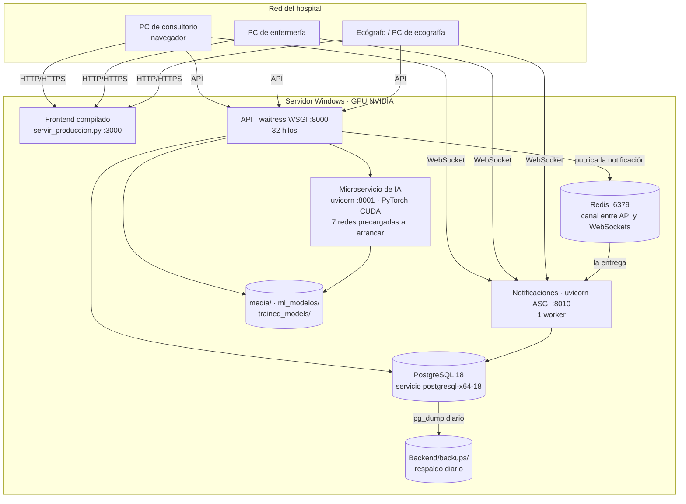
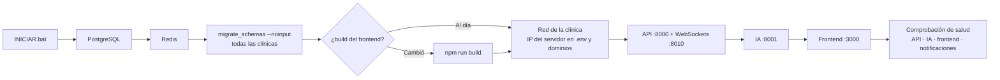

# 11 · Despliegue y operación

## Diagrama de despliegue (un servidor del hospital)

En una instalación con dominio y certificado, `Backend/nginx.conf` termina
TLS (443) delante de los tres servicios.

## Puertos

| Servicio | Puerto | Salud |
|---|---|---|
| Frontend | 3000 | `http://servidor:3000` |
| API (waitress, WSGI) | 8000 | `http://servidor:8000/api/` (200/401) |
| Notificaciones en tiempo real (uvicorn, ASGI) | 8010 | `ws://servidor:8010/ws/notifications/` (con sesión) |
| Microservicio de IA | 8001 | `http://servidor:8001/health` (200 con modelos y la lista de redes precargadas; 503 sin modelo) |
| PostgreSQL | 5432 | servicio de Windows |
| Redis | 6379 (solo local) | `redis-cli ping` → `PONG` |

## Por qué la API va en WSGI y los WebSockets aparte

Medido el 01/10/2026 con la demo de 3.200 pacientes (`quality-assurance/medir_latencia_api.py`):
con uvicorn (ASGI) en Windows cada petición sumaba 50–100 ms de paso entre
hilos y el percentil 95 de los listados quedaba en 200–250 ms; con waitress
(WSGI) la mediana es de 5–53 ms y el percentil 95 queda bajo 200 ms en las 16
rutas. Con 40 usuarios simultáneos y pausas reales: 9 peticiones/s, mediana 49
ms, 0 errores. Los WebSockets necesitan ASGI y van en su propio puerto; el
frontend de producción los busca en el 8010 (o en `REACT_APP_WS_URL`).

**Redis es obligatorio en producción.** La notificación la crea la API
(waitress) y el WebSocket abierto vive en otro proceso (uvicorn). La capa en
memoria de Channels no cruza procesos, y el frontend deja de sondear en cuanto
el WebSocket conecta: sin Redis las alertas no aparecían hasta recargar la
página (comprobado el 01/10/2026: con Redis la notificación llega en 0,16 s;
sin él, nunca). `INICIAR.bat` arranca Redis y pasa `REDIS_URL` a los
dos procesos; si falta, `manage.py check` lo advierte
(`notifications_websocket.W001`). Se usa la capa pub/sub con protocolo RESP2,
que funciona con el Redis 3.0 para Windows instalado (no conoce `HELLO` ni
`BZPOPMIN`) y con cualquier Redis moderno. Los WebSockets van con un solo
worker: es asíncrono, y con varios, en Windows, había conexiones que se
quedaban colgadas en el socket compartido.

**PostgreSQL debe correr como servicio de Windows** (`net start
postgresql-x64-18`, con permisos de administrador) y con los ajustes de
`APLICAR_AJUSTES_POSTGRES.bat` (`max_connections = 300`). Iniciado a mano
desde una sesión de usuario, Windows a veces le impide crear el proceso de una
conexión nueva («could not reserve shared memory region», error 487) y algunas
peticiones se quedan colgadas.

## Arranque

| Lanzador | Para qué |
|---|---|
| `INICIAR.bat` | Hospital (por defecto): PostgreSQL, Redis, migraciones de todas las clínicas, build del frontend si cambió, red de la clínica, API en waitress (8000), WebSockets en uvicorn (8010), IA (8001), frontend (3000) y comprobación de salud |
| `INICIAR.bat desarrollo` | Para programar: recarga automática del backend y servidor de desarrollo de React |
| `INICIAR.bat detener` | Cierra los servicios del sistema (puertos 3000, 8000, 8001, 8010) |
| `MIGRAR_Y_SEED.bat` | Solo demostración: migraciones y datos ficticios (nunca en el hospital) |
| `RESPALDO_DIARIO.bat` | Respaldo de la base (programar en el Programador de tareas) |

## Acceso con dos factores (MFA)

En producción (`DEBUG=False`) médicos y administradores necesitan Google
Authenticator. La primera vez que entran, el sistema los lleva a configurarlo
(QR y primer código) y al terminar ya quedan dentro; no hace falta que nadie los
ayude. Si alguien pierde o cambia el celular, el administrador abre
**Usuarios → Restablecer MFA** (icono de escudo): la persona lo configura de
nuevo al entrar y el hecho queda en la auditoría como `MFA_RESTABLECIDO`.

## Configuración (`Backend/.env`)

| Variable | Uso |
|---|---|
| `SECRET_KEY`, `DEBUG`, `ALLOWED_HOSTS` | Django |
| `DB_*` | Conexión a PostgreSQL |
| `ENCRYPTION_KEY`, `ENCRYPTION_SALT`, `SEARCH_HMAC_KEY` | Cifrado de datos de pacientes y hash de búsqueda — **perderlas hace ilegibles los datos** |
| `AI_SERVICE_URL` | Dirección del microservicio de IA |
| `CORS_ALLOWED_ORIGINS`, `CSRF_TRUSTED_ORIGINS` | Orígenes permitidos del frontend |
| `CSRF_COOKIE_SECURE`, `SESSION_COOKIE_SECURE`, `SECURE_*` | Endurecimiento con HTTPS |
| `REDIS_URL` | **Obligatoria en producción**: notificaciones en tiempo real entre la API y los WebSockets, y caché (la define `INICIAR.bat`) |
| `CELERY_BROKER_URL` | Opcional: cola de tareas |

Con `VAULT_ADDR` y `VAULT_TOKEN` los secretos se leen de HashiCorp Vault.

## Seguridad aplicada

```mermaid
flowchart LR
    subgraph Entrada
        A1[JWT en cookie httpOnly]
        A2[CSRF en escrituras]
        A3[Límite de intentos de login]
    end
    subgraph Autorización
        B1[Permisos por rol<br/>en API y pantallas]
        B2[Recepción sin datos clínicos]
        B3[/media/ protegida/]
    end
    subgraph Datos
        C1[Campos personales cifrados]
        C2[Archivos validados<br/>por contenido]
        C3[Historia protegida<br/>contra borrado]
    end
    subgraph Trazabilidad
        D1[Auditoría inmutable<br/>por sesión]
        D2[Exportaciones auditadas]
    end
    Entrada --> Autorización --> Datos --> Trazabilidad
```

## Respaldo y restauración

- `python manage.py respaldar_base --conservar 30` genera un `.sql` en
  `Backend/backups/` y borra los de más de 30 días. La restauración se
  verificó (mismo número de pacientes, 0 errores).
- Respaldar también `Backend/.env` (claves de cifrado) en un lugar seguro y
  separado: sin ellas el respaldo no se puede leer.

## Puesta en marcha en un hospital (resumen)

1. Instalar PostgreSQL 18, Python 3.12, Node 18+ y el controlador NVIDIA (para la IA).
2. Crear `Backend/.venv` e instalar `requirements.lock.txt`; instalar las dependencias del microservicio y del frontend.
3. Configurar `Backend/.env` con claves nuevas y la IP o dominio del servidor.
4. Crear la clínica (tenant) y su dominio; cargar el catálogo de laboratorio (`poblar_valores_referencia`).
5. Copiar los modelos de IA a `Backend/Microservicio_IA/trained_models/`.
6. Ejecutar `INICIAR.bat` y programar `RESPALDO_DIARIO.bat`.
7. Crear los usuarios con su rol; los permisos se asignan solos.
