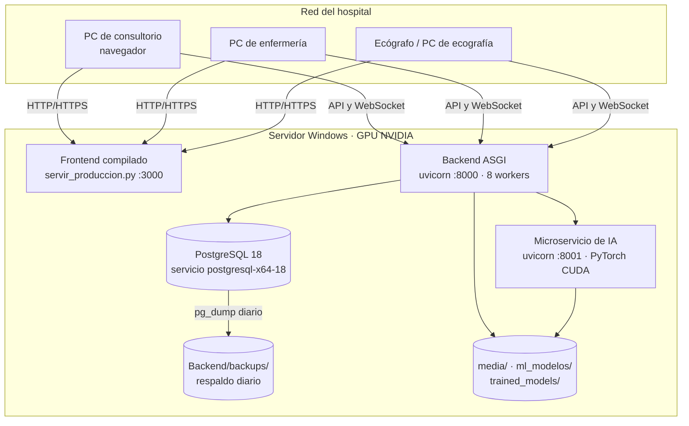
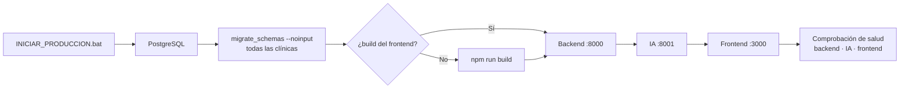

# 11 · Despliegue y operación

## Diagrama de despliegue (un servidor del hospital)

En una instalación con dominio y certificado, `Backend/nginx.conf` termina
TLS (443) delante de los tres servicios.

## Puertos

| Servicio | Puerto | Salud |
|---|---|---|
| Frontend | 3000 | `http://servidor:3000` |
| Backend (API y WebSocket) | 8000 | `http://servidor:8000/api/` (200/401) |
| Microservicio de IA | 8001 | `http://servidor:8001/health` (200 con modelos; 503 sin modelo) |
| PostgreSQL | 5432 | servicio de Windows |

## Arranque

| Lanzador | Para qué |
|---|---|
| `INICIAR_PRODUCCION.bat` | Hospital: PostgreSQL, migraciones de todas las clínicas, build del frontend, 8 workers, comprobación de salud |
| `INICIAR_SISTEMA.bat` | Desarrollo: recarga automática del backend y servidor de desarrollo de React |
| `MIGRAR_Y_SEED.bat` | Solo demostración: migraciones y datos ficticios (nunca en el hospital) |
| `RESPALDO_DIARIO.bat` | Respaldo de la base (programar en el Programador de tareas) |

## Configuración (`Backend/.env`)

| Variable | Uso |
|---|---|
| `SECRET_KEY`, `DEBUG`, `ALLOWED_HOSTS` | Django |
| `DB_*` | Conexión a PostgreSQL |
| `ENCRYPTION_KEY`, `ENCRYPTION_SALT`, `SEARCH_HMAC_KEY` | Cifrado de datos de pacientes y hash de búsqueda — **perderlas hace ilegibles los datos** |
| `AI_SERVICE_URL` | Dirección del microservicio de IA |
| `CORS_ALLOWED_ORIGINS`, `CSRF_TRUSTED_ORIGINS` | Orígenes permitidos del frontend |
| `CSRF_COOKIE_SECURE`, `SESSION_COOKIE_SECURE`, `SECURE_*` | Endurecimiento con HTTPS |
| `REDIS_URL`, `CELERY_BROKER_URL` | Opcionales: canales, caché y cola |

Con `VAULT_ADDR` y `VAULT_TOKEN` los secretos se leen de HashiCorp Vault.

## Seguridad aplicada

```mermaid
flowchart LR
    subgraph Entrada
        A1[JWT en cookie httpOnly]
        A2[CSRF en escrituras]
        A3[Límite de intentos de login]
    end
    subgraph Autorización
        B1[Permisos por rol<br/>en API y pantallas]
        B2[Recepción sin datos clínicos]
        B3[/media/ protegida/]
    end
    subgraph Datos
        C1[Campos personales cifrados]
        C2[Archivos validados<br/>por contenido]
        C3[Historia protegida<br/>contra borrado]
    end
    subgraph Trazabilidad
        D1[Auditoría inmutable<br/>por sesión]
        D2[Exportaciones auditadas]
    end
    Entrada --> Autorización --> Datos --> Trazabilidad
```

## Respaldo y restauración

- `python manage.py respaldar_base --conservar 30` genera un `.sql` en
  `Backend/backups/` y borra los de más de 30 días. La restauración se
  verificó (mismo número de pacientes, 0 errores).
- Respaldar también `Backend/.env` (claves de cifrado) en un lugar seguro y
  separado: sin ellas el respaldo no se puede leer.

## Puesta en marcha en un hospital (resumen)

1. Instalar PostgreSQL 18, Python 3.12, Node 18+ y el controlador NVIDIA (para la IA).
2. Crear `Backend/.venv` e instalar `requirements.lock.txt`; instalar las dependencias del microservicio y del frontend.
3. Configurar `Backend/.env` con claves nuevas y la IP o dominio del servidor.
4. Crear la clínica (tenant) y su dominio; cargar el catálogo de laboratorio (`poblar_valores_referencia`).
5. Copiar los modelos de IA a `Backend/Microservicio_IA/trained_models/`.
6. Ejecutar `INICIAR_PRODUCCION.bat` y programar `RESPALDO_DIARIO.bat`.
7. Crear los usuarios con su rol; los permisos se asignan solos.
