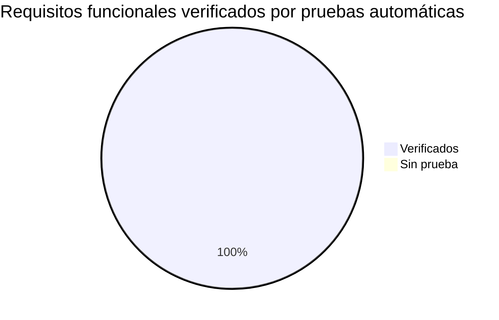
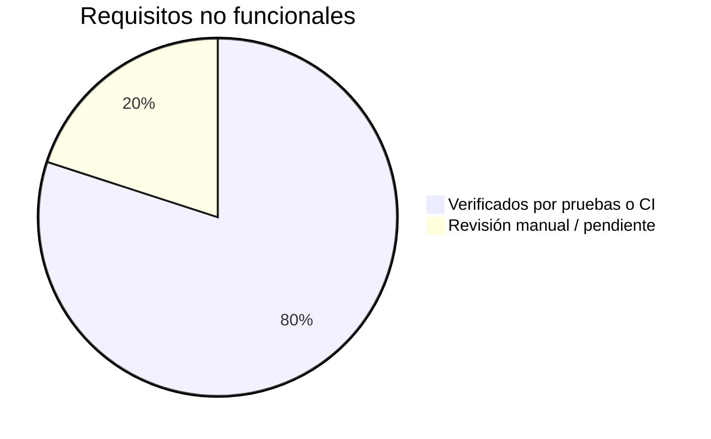

# 12 · Trazabilidad

Relaciona cada requisito con las historias de usuario, los casos de uso y los
casos de prueba que lo cubren. El estado corresponde a la corrida del
01/10/2026, en la que **todos los casos de prueba pasaron** (backend, frontend,
microservicio de IA, E2E en el navegador y rendimiento). El resultado
actualizado de cada caso está en [QA_CASOS_DE_PRUEBA.md](../QA_CASOS_DE_PRUEBA.md);
para regenerarlo: `python quality-assurance/casos_de_prueba.py`.

## Requisitos funcionales

| Requisito | Historias | Casos de uso | Casos de prueba | Estado |
|---|---|---|---|---|
| RF-01 Registrar paciente con consentimiento | HU-01 | CU-01, CU-02 | CP-001 | ✅ Verificado |
| RF-02 Búsqueda en datos cifrados | HU-02 | CU-02 | CP-002 | ✅ Verificado |
| RF-03 Importar pacientes desde Excel | HU-03 | CU-02 | CP-003 | ✅ Verificado |
| RF-04 Listados paginados en el servidor | HU-12 | CU-07 | CP-004, CP-020, CP-060 | ✅ Verificado |
| RF-05 Embarazo, EG y datación | HU-04 | CU-01 | CP-010, CP-011, CP-012 | ✅ Verificado |
| RF-06 Control prenatal con alertas | HU-05 | CU-01, CU-03 | CP-020, CP-021 | ✅ Verificado |
| RF-07 Ecografía, biometría y peso fetal | HU-06 | CU-01, CU-04 | CP-030, CP-032 | ✅ Verificado |
| RF-08 Adjuntos de la ecografía | HU-17 | CU-04 | CP-037 | ✅ Verificado |
| RF-09 Análisis con redes medidas (plano, segmentación, anomalías) | HU-07 | CU-01, CU-04 | CP-032 a CP-035, CP-038, CP-039 | ✅ Verificado |
| RF-10 Predicción de peso al nacer y cierre con el peso real | HU-08 | CU-04 | CP-036, CP-084 | ✅ Verificado |
| RF-11 Parto con recién nacidos, en 5 pestañas | HU-09 | CU-01, CU-05 | CP-040, CP-041 | ✅ Verificado |
| RF-12 Catálogo y evaluación de laboratorio | HU-10 | CU-06 | CP-050, CP-051, CP-052 | ✅ Verificado |
| RF-13 Importar resultados de laboratorio (Excel o CSV, mapeo, deshacer) | HU-10, HU-23 | CU-06 | CP-053, CP-054, CP-055 | ✅ Verificado |
| RF-14 Vacunas y dosis pendientes | HU-12 | — | CP-060, CP-061 | ✅ Verificado |
| RF-15 Notas de evolución | HU-18 | — | CP-070 | ✅ Verificado |
| RF-16 Triaje con prioridad | HU-11 | — | CP-071 | ✅ Verificado |
| RF-17 Calculadoras clínicas | HU-13 | — | CP-030, CP-080, CP-081, CP-082 | ✅ Verificado |
| RF-18 Centro de reportes (período común, natalidad, IA, impresión) | HU-14, HU-24 | CU-07 | CP-105, CP-107 | ✅ Verificado |
| RF-19 Exportar a Excel | HU-14 | CU-07 | CP-106 | ✅ Verificado |
| RF-20 Recordatorios y alertas | HU-16 | — | CP-100 | ✅ Verificado |
| RF-21 Acceso por rol | HU-15 | CU-08 | CP-090, CP-091, CP-093 | ✅ Verificado |
| RF-22 Auditoría | HU-15 | CU-08 | CP-092 | ✅ Verificado |
| RF-23 Historia clínica protegida | — | CU-08 | CP-013 | ✅ Verificado |
| RF-24 Partograma con líneas de alerta y acción | HU-19 | CU-05 | CP-044 | ✅ Verificado |
| RF-25 Capurro / Ballard del recién nacido | HU-20 | CU-05 | CP-043 | ✅ Verificado |
| RF-26 Epicrisis firmada y en PDF | HU-21 | CU-05 | CP-042 | ✅ Verificado |
| RF-27 Campos propios del establecimiento | HU-24 | CU-08 | CP-042 | ✅ Verificado |
| RF-28 Ángulo de progresión intraparto | HU-19 | CU-05 | CP-045 | ✅ Verificado |
| RF-29 Cardiotocografía con IA | HU-22 | CU-03 | CP-083 | ✅ Verificado |
| RF-31 Ecografía ginecológica con IA | HU-26 | CU-04 | CP-085, CP-086, CP-087 | ✅ Verificado |
| RF-30 Cargos del hospital (otros funcionarios) | HU-25 | CU-08 | CP-112 | ✅ Verificado |

## Requisitos no funcionales

| Requisito | Casos de prueba | Estado |
|---|---|---|
| RNF-01 Rendimiento | CP-110, CP-111 | ✅ Verificado |
| RNF-02 Robustez | CP-102, CP-035 | ✅ Verificado |
| RNF-03 Seguridad | CP-031, CP-037 | ✅ Verificado |
| RNF-04 Privacidad | CP-002, CP-004 | ✅ Verificado |
| RNF-05 Trazabilidad | CP-092 | ✅ Verificado |
| RNF-06 Exactitud clínica | CP-030, CP-051, CP-080, CP-081, CP-082 | ✅ Verificado |
| RNF-07 Honestidad de la IA | CP-033, CP-034, CP-036, CP-038, CP-083 | ✅ Verificado |
| RNF-08 Localización | CP-100 | ✅ Verificado |
| RNF-09 Operabilidad | CP-101 | ✅ Verificado |
| RNF-10 Calidad de datos | CP-103 | ✅ Verificado |
| RNF-11 Usabilidad y accesibilidad | — | 📝 Revisión manual |
| RNF-12 Mantenibilidad | CI (ruff, pytest, tsc, eslint) | ✅ Verificado en CI |
| RNF-13 Escalabilidad multi-clínica | — | 📝 Por arquitectura (django-tenants) |
| RNF-14 Disponibilidad bajo carga | `prueba_concurrencia.py`: 40 usuarios, 0 errores | 📝 Medido en el equipo de desarrollo; repetir en el servidor del hospital |
| RNF-15 Extensibilidad | CP-042 | ✅ Verificado |
| RNF-16 Fiabilidad de las alertas | CP-108 | ✅ Verificado |

## Cobertura

