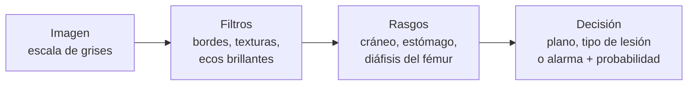

# 13 · Guía de IA para el usuario

Manual para médicos, ecografistas y ginecólogas: qué hace cada modelo de
inteligencia artificial del sistema, **dónde se usa**, **qué devuelve** y
**cuánto se le puede creer**. La misma información está dentro del sistema en
el menú **Estudios Auxiliares → Guía de IA** (`/dashboard/ia-guia`), con un
botón «Usar ahora» que lleva a la pantalla de cada modelo.

> **La IA apoya, no diagnostica.** Cada resultado es una segunda opinión con su
> margen de error medido en pacientes que el modelo no vio. La decisión y la
> responsabilidad son del médico (Ley 3131).

Las cifras de este documento son las que dejó cada entrenamiento
(`Backend/Microservicio_IA/trained_models/*.json`, `entrenamiento/**/metricas.json`,
`Backend/ml_modelos/*/ficha.json`) y coinciden con
[10 · Inteligencia artificial](10_inteligencia_artificial.md). En la pantalla
no están escritas a mano: la Guía de IA y la pestaña «Modelos y métricas» las
piden al backend (`GET /api/ia/imagenes/modelos/`), que las lee de esos
archivos. Si se reentrena un modelo, cambian solas.

## 1. Cómo funcionan, en palabras simples

### Qué quiere decir «supervisado»

Todos los modelos del sistema son **supervisados**: aprendieron de miles de
ejemplos que un experto ya había etiquetado («este corte es un fémur», «este es
el contorno del cráneo», «este registro es patológico»). Al entrenar, el modelo
ajusta sus parámetros para equivocarse lo menos posible contra esas etiquetas.
Después se lo mide en pacientes que nunca vio, y esa medida es la que se
publica.

### Red neuronal convolucional (CNN)

Mira la ecografía como alguien que aprende a leerla: primero detalles pequeños,
después formas, después el conjunto. Cada capa pasa sobre la imagen unos
«filtros» que se activan con un patrón.

En el sistema: plano anatómico, cribado de anomalías cerebrales, tipo de lesión
ovárica, ovario poliquístico y circunferencia cefálica por regresión
(EfficientNet-B0).

### Segmentación U-Net

Es una CNN que, en lugar de una sola respuesta, **colorea cada píxel** («esto es
cráneo», «esto es corazón»). Primero comprime la imagen para entender qué hay y
luego la vuelve a ampliar para dibujar el contorno exacto. Sobre ese contorno el
sistema **mide** (elipse, diámetros, ángulo) y aplica la fórmula publicada
(Hadlock para la edad gestacional). Usted ve el dibujo y comprueba de dónde salió
cada medida.

En el sistema: cabeza, tórax y corazón, abdomen, ecografía intraparto, masa
ovárica y mioma.

### Red de puntos (mapas de calor)

Para el fémur y el abdomen no hace falta el contorno sino **dónde van los
calibradores**. La red produce un mapa de calor por cada punto (más brillante
donde es más probable el extremo), el sistema toma el punto más probable y mide
la distancia, como el ecografista.

### Modelo supervisado de tabla (cardiotocografía)

No usa imagen: usa las cifras que calcula el monitor (línea de base,
aceleraciones, desaceleraciones, variabilidad, histograma). Es un **gradient
boosting**: muchos árboles de decisión pequeños («si la variabilidad es baja y
hay desaceleraciones prolongadas…»), cada uno corrige los errores de los
anteriores. Aprendió de registros clasificados por consenso de tres obstetras.

### Por qué no se usa aprendizaje no supervisado para decidir

El aprendizaje no supervisado agrupa casos parecidos sin que nadie diga qué es
cada grupo. Sirve para explorar datos, pero un grupo no es un diagnóstico y no
hay contra qué medir cuánto acierta. Para apoyar una decisión clínica el sistema
solo usa modelos que se pueden comparar con la etiqueta de un experto en
pacientes que no vieron.

## 2. Modelo por modelo

Ruta de las pantallas: **Análisis CNN (IA)** = `/dashboard/ia-medica/imagenes`
(pestañas Ecografía, Ecografía ginecológica, Cardiotocografía, Modelos y
métricas). El **tamaño de píxel** (mm por píxel) lo da el ecógrafo o la cabecera
DICOM; sin él las medidas salen en píxeles y el sistema lo avisa.

### Ecografía obstétrica

| Modelo | Dónde hacer clic | Qué obtiene | Cuánto creerle (medido en pacientes no vistas) |
|---|---|---|---|
| **Plano anatómico** (CNN EfficientNet-B0) | Análisis CNN (IA) → Ecografía → «Redes entrenadas con ecografías reales» → subir imagen → **Analizar**. También en cada ecografía guardada → pestaña «IA medida» | El plano (cerebro, abdomen, fémur, tórax, cuello uterino materno u otro) con su probabilidad | 92,7 % de exactitud en 5.271 imágenes de 896 madres (FETAL_PLANES_DB). Reconoce solo el 58,8 % de las cabezas del primer trimestre |
| **Cribado de anomalías cerebrales** (CNN) | El mismo botón **Analizar**, con un corte axial de la cabeza | «Sin alarma» o la familia sospechada (ventriculomegalia/hidrocefalia, fosa posterior, encefalocele, lesión quística o vascular) y su probabilidad | Falsas alarmas: 1 de 1.866 cabezas normales de otro hospital. **Cuántas anomalías detecta en ecografías clínicas no se puede medir con datos públicos: «sin alarma» no descarta** |
| **Circunferencia cefálica por regresión** (CNN) | **Analizar** con el tamaño de píxel escrito | CC en mm y edad gestacional | R² 0,978, error medio 7,0 mm en 146 imágenes de 117 madres (HC18). La U-Net de cabeza mide mejor |
| **Segmentación de cabeza** (U-Net) | Subir un corte transtalámico, escribir el tamaño de píxel → **Informe completo** | Cráneo, cavum y ventrículo dibujados; CC y DBP en mm con su margen; edad gestacional por CC y por DBP (Hadlock) | En otro hospital (HC18, 999 imágenes): error medio 4,4 mm, 92 % dentro del 5 %. Error mayor en el primer trimestre |
| **Segmentación de tórax** (U-Net) | Corte de cuatro cámaras → **Informe completo** | Tórax y corazón dibujados; índice cardiotorácico por áreas y por circunferencias | Dice 0,93; índice ±0,02 en 50 imágenes (FOCUS). **Solo vio corazones normales: mide el índice, no detecta cardiopatías** |
| **Segmentación abdominal** (U-Net) | Corte transversal del abdomen → **Informe completo** | Estómago, vena umbilical, hígado y aorta; si el corte es adecuado para medir la CA | Dice 0,75; estómago visto en el 92 % de 245 imágenes de 26 pacientes |
| **Circunferencia abdominal** (red de puntos) | El mismo **Informe completo** del abdomen, con tamaño de píxel | Diámetros transverso y anteroposterior y CA en mm, con su margen | Error relativo 2,9 % (mediana 2,9 mm), 89 % dentro del 5 % en 134 imágenes (Barcelona y Londres) |
| **Longitud del fémur** (red de puntos) | Corte del fémur, tamaño de píxel → **Informe completo** | LF en mm con su margen y los calibres dibujados | Error medio 1,3 mm (mediana 0,6 mm), 92 % dentro del 5 % en 353 imágenes de 271 pacientes |

El **Informe completo** también se abre desde la galería (elegir paciente →
subir imagen → «Analizar con IA»); ahí el resultado queda guardado con la
imagen y se puede vincular a una ecografía y redactar con la IA local.

### Trabajo de parto

| Modelo | Dónde hacer clic | Qué obtiene | Cuánto creerle |
|---|---|---|---|
| **Ángulo de progresión** (U-Net, ecografía transperineal) | Partos → abrir un parto → pestaña «Trabajo de parto» → Partograma → **Registrar tacto** → **Subir imagen y medir** | AoP en grados con su margen, sínfisis y cabeza dibujadas; el valor se copia al tacto | Error medio 6,7° en 300 imágenes de otros años (IUGC 2024). Con el corte de 120°: sensibilidad 65 %, especificidad 96 %. **Es una medida, no una decisión**: revise el dibujo antes de guardar |

### Ecografía ginecológica

Análisis CNN (IA) → pestaña **Ecografía ginecológica** → elegir qué analizar →
elegir la imagen → **Analizar**.

| Modelo | Opción | Qué obtiene | Cuánto creerle |
|---|---|---|---|
| **Lesión ovárica: contorno** (U-Net) | «Masa ovárica» | La lesión dibujada; ancho y alto (mm con tamaño de píxel) | Dice 0,85; lesión encontrada en el 88 % de 436 imágenes de 434 pacientes (MMOTU) |
| **Tipo de lesión ovárica** (ensamble de 2 CNN) | «Masa ovárica» | Tipo probable entre 8 y la alarma de carcinoma seroso de alto grado | 68,6 % de exactitud (IC95 64–73 %). La alarma de carcinoma detecta 7 de 13 con 97,6 % de especificidad: **sin alarma NO descarta un cáncer**. Orientación; deciden O-RADS y la anatomía patológica |
| **Mioma uterino** (U-Net) | «Mioma uterino» | Ubicación del mioma (recuadro y contorno) | Ubicado en el 96,9 % de 128 imágenes de 118 pacientes. **Solo vio úteros con mioma: sirve para ubicarlo, no para descartarlo** |
| **Ovario poliquístico** (CNN) | «Ovario poliquístico» | Normal, folículo dominante o poliquístico, con probabilidades | 80,0 % de exactitud (IC95 75–84 %), 5 pliegues. El SOP se diagnostica con los criterios de Rotterdam, no con una imagen |

### Monitoreo fetal

| Modelo | Dónde hacer clic | Qué obtiene | Cuánto creerle |
|---|---|---|---|
| **Cardiotocografía** (gradient boosting, tabla) | Análisis CNN (IA) → pestaña **Cardiotocografía** → copiar los 21 valores del informe automático del monitor → **Clasificar** | Normal, sospechosa o patológica, con probabilidades y límites | 96,0 % de exactitud (IC95 94,1–97,6 %) en 423 registros; detecta el 94,3 % de las patológicas. Un hospital (Porto) y un programa (SisPorto): validar con el monitor propio |

### En demostración

| Modelo | Dónde hacer clic | Qué obtiene | Cuánto creerle |
|---|---|---|---|
| **Peso al nacer** (regresión supervisada, tabla) | Ecografías → abrir una ecografía con biometría → pestaña «Biometría» → **Peso al nacer previsto** → **Calcular** | Peso previsto con su margen y el de Hadlock al lado | Error medio 183 g **en partos simulados**: es una demostración hasta reentrenarlo con partos reales del hospital. No predice en embarazos múltiples ni antes de las 20 semanas |

## 3. Evaluados y descartados

Se entrenaron y se midieron con datos reales y **no se pueden usar desde
ninguna pantalla**. La Guía de IA los muestra con su motivo.

| Modelo | Lo que se midió | Por qué se descartó |
|---|---|---|
| Acidemia al nacer desde la señal del monitoreo (CTU-UHB) | AUC 0,73; para detectar el 90 % de las acidemias, especificidad 33 % | Demasiadas falsas alarmas para decidir una conducta |
| Parto prematuro desde el electrohisterograma (TPEHG) | AUC 0,42–0,43 en validación cruzada | No distingue mejor que el azar |
| Calidad del corte para la translucencia nucal (CNN) | 94,8 % en el mismo hospital; 68,6 % en otra sede | No generaliza a otro centro |
| Cardiopatía congénita por variables maternas (CARDIUM) | AUC 0,70; valor predictivo positivo 7–9 % | Más de 90 de cada 100 alarmas serían falsas |
| Cáncer cervicouterino por factores de riesgo (UCI 383) | AUC 0,60 solo con factores de riesgo | No supera a la referencia clínica (el tamizaje) |
| Riesgo materno general (UCI 863) | Exactitud balanceada 71 % en 77 casos | La etiqueta del dataset no tiene criterio clínico |
| EfficientNet-B4 de «14 patologías» | Sin métrica válida | Retirada el 01/10/2026: etiquetas no verificables |

## 4. Lo que no es IA

| Herramienta | Qué es |
|---|---|
| Asistente de consulta (`/dashboard/ia-asistente` y panel principal) | Busca palabras clave en una base de conocimiento obstétrica escrita a partir de guías. No aprende ni tiene una exactitud medida; si el servicio no responde, lo dice y no inventa una respuesta |
| Interpretación de laboratorio | Compara cada valor con los rangos del embarazo: reglas fijas |
| Calculadoras (FMF, preeclampsia, Hadlock, Capurro…) | Fórmulas publicadas; valen lo que vale la publicación |

## 5. Comprobación

Cada fila de este documento se usa de punta a punta en
`Backend/e2e/tests/ia-modelos.spec.js` (desde la Guía de IA y sus botones, con
imágenes y registros reales de prueba); la masa ovárica y el mioma, en
`ginecologia.spec.js`. Las cifras de la guía se comparan con los archivos del
entrenamiento en `Backend/tests/test_guia_ia.py` y la forma de las métricas del
microservicio en `Backend/Microservicio_IA/test_contrato_modelos.py`. Caso de
prueba: **CP-114**. Requisito: **RF-33** · Historia: **HU-28**.
